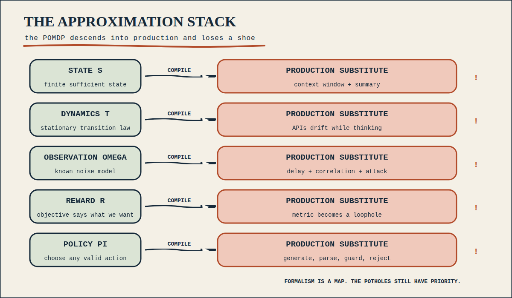

# Goals, Environments, and Actions

Agent-427 is born with a narrow constitution: it may inspect the repository, but it may not write, deploy, or remember anything durably. Before anything clever can happen, it needs three things: something it is trying to achieve, a world it is acting inside, and a list of moves it is allowed to make. Those three things get written down here as a contract. Every later chapter extends that contract, and it is the first thing you inspect when an agent misbehaves.

An agent is not a model that emits impressive text. It is an interpreter for situated action. At each step it does four things:

- it reads a partial observation, meaning it sees only some of what is going on;
- it updates what it thinks is going on;
- it chooses an admissible action, meaning one the system permits;
- it accepts that the action changes the next problem it must solve.

Before we can discuss belief, memory, planning, or control, we need the contract that this interpreter is running.

## The Three Parts of the Contract

The contract has three parts, and each answers a different question:

- A **goal** says what outcomes count as better or worse.
- An **environment** says what can change outside the agent, and what the agent can observe.
- An **action vocabulary** says which interventions are legal, costly, reversible, and checkable.

Without these parts, the system may still be useful. But its behavior is difficult to compare, debug, or govern [[2](../../references.md#ref-2)]. That difficulty is the practical cost of leaving the contract implicit.

## A Coding Agent Under Deadline

Imagine a coding agent tasked with shipping a bug fix before a release freeze. Its goal is not "write something clever." A defensible goal combines four pressures at once:

- the value of the task itself;
- the risk of causing a regression, meaning breaking something that used to work;
- deadline pressure;
- cost.

Its environment is only partly visible to it. That environment includes a partially observed repository, flaky continuous integration (CI, the automated system that builds and tests each change), hidden downstream dependencies, and a user whose constraints may be underspecified.

Its actions are ordinary engineering moves: reading files, editing code, running tests, asking for clarification, and opening a pull request. Each action does three things at once. It produces an observation, it consumes budget, and it may make later actions easier or harder [[3](../../references.md#ref-3)] [[7](../../references.md#ref-7)].

## The Smallest Agent Interpreter

This is already enough to write the smallest agent interpreter. The pseudocode below keeps a running `state` and a `history` of what happened, then loops: observe, update, choose, execute, record.

```text
state <- initial_state()
history <- []

while not terminated(state, history):
    observation <- observe(environment, state)
    state <- update_state(state, observation)
    action <- choose_action(goal, state, legal_actions(state))
    outcome <- execute(action)
    history <- history + [(observation, action, outcome)]
```

This loop is the experimental baseline for the rest of the book. Before adding retrieval, planning, reflection, tool governance, or multiple agents, we can ask what this plain interpreter achieves on its own. Five measurements are enough to start:

- whether it completes the task;
- how far it gets before stopping;
- how many tokens and tool calls it spends;
- how long it waits on feedback;
- which failures remain.

Later patterns are not magic additions. They are controlled mutations of this loop, and each one should be judged against the baseline this plain interpreter sets.

The rest of the chapter refines the three vague functions in this loop. Topic 2 (Belief, Uncertainty, and Decision) asks what `update_state` should mean when the world is uncertain. Topic 3 (World Models and State Abstractions) asks what information belongs in `state` rather than in the raw transcript. Topic 4 (Policies, Value, and Control) asks how `choose_action` becomes a policy that remains useful under constraints and feedback.

## Formal Contract

A common mathematical model is a partially observable Markov decision process (POMDP) with constraints. "Partially observable" means the agent cannot see the true state directly. The model is written as an eight-part tuple:

\[
\mathcal{M}=(\mathcal{S},\mathcal{O},\mathcal{A},T,\Omega,R,C,\gamma).
\]

> **Try this with numbers.** Step 1: give a toy world \(2\) states, \(3\) observations, and \(4\) legal actions. Step 2: its explicit state-action table already needs \(2\times4=8\) entries before transitions, costs, or observations arrive.

Read that aloud as "the model M consists of states S, observations O, actions A, transitions T, observation model Omega, reward R, cost C, and discount gamma." Eight symbols in a single line is a lot to hold in mind, so the table in "From Symbols to Interfaces" maps each one to a field you would actually implement.

### States, Observations, and Actions

Here \(\mathcal{S}\) is **latent world state**: the complete condition of the world that matters but is not directly visible. For the coding agent, \(s\in\mathcal{S}\) ("a state s drawn from the set S") might include the real bug location, whether a dependency is stale, and whether an unseen integration test will fail. The word latent simply means "present in the world, hidden from the agent's sensors."

\(\mathcal{O}\) is the set of observations, such as file contents, test output, logs, and user messages. \(\mathcal{A}\) is the action set, including `read_file`, `edit_file`, `run_tests`, `ask_user`, and `open_pr`.

### How the World Moves and What the Agent Sees

The term \(T(s'\mid s,a)\) is the **transition dynamics**. Read it as "the chance the next hidden state is s-prime, given the current state s and action a." If \(a\) is `edit_file`, \(T\) describes how likely that edit is to move the repository from "bug present" to "bug fixed" or, less gloriously, to "new regression introduced."

The term \(\Omega(o\mid s,a)\) is the **observation model**. Read it as "the chance the agent sees observation o after action a when the world is in state s." A flaky test suite has an observation model with noise: the same hidden state can produce a pass one minute and a failure the next.

The last three symbols are the scoring machinery. \(R(s,a)\) is reward, \(C(s,a)\) is constraint cost, and \(\gamma\in(0,1)\) is a **discount factor**, a number strictly between zero and one that makes nearer consequences count more than distant ones [[4](../../references.md#ref-4)] [[7](../../references.md#ref-7)] [[51](../../references.md#ref-51)].

### The Markov Assumption Is a Design Choice

The Markov assumption is an interpretation, not a fact about reality. It says that the state representation is rich enough that the next transition can be modeled from the current state and action alone. When that assumption fails, the repair is usually one of three moves: better state, better memory, or a more cautious policy.

### Reading the Objective, with Two Numbers

A policy \(\pi(a\mid h_t)\), with history \(h_t=(o_{0:t},a_{0:t-1})\), is evaluated by expected return subject to constraints. A **policy** is the rule for choosing actions. The notation \(\pi(a\mid h_t)\) reads "the probability that the policy chooses action \(a\) given history \(h_t\)," where the history holds every observation up to step \(t\) and every action before it.

Before the infinite sum appears, consider two concrete steps with \(\gamma=0.9\). Suppose `read_file` earns immediate reward \(R_0=1\) because it gathers useful evidence, and `edit_file` earns \(R_1=8\) after the evidence points to the right line. The two-step discounted return is

\[
R_0+\gamma R_1 = 1 + 0.9\cdot 8 = 8.2.
\]

> **Try this with numbers.** Step 1: discount the later reward: \(0.9\times8=7.2\). Step 2: add the immediate reward: \(1+7.2=8.2\).

If the first action instead rushed an edit with \(R_0=4\) but caused a next-step regression \(R_1=-5\), the return would be \(4+0.9(-5)=-0.5\). Patience wins here by more than eight points. Discounting does not worship delay; it merely lets the contract compare immediate temptation with later consequence.

The full objective extends that arithmetic over all future steps, and adds a budget line for every kind of cost:

\[
\max_{\pi}\;J(\pi)=\mathbb{E}_{\pi,T,\Omega}\!\left[\sum_{t=0}^{\infty}\gamma^t R(s_t,a_t)\right]
\quad\text{s.t.}\quad
\mathbb{E}_{\pi}\!\left[\sum_{t=0}^{\infty}\gamma^t C_j(s_t,a_t)\right]\le\kappa_j\;\forall j.
\]

> **Try this with numbers.** Step 1: rewards \(4\) now and \(6\) next at \(\gamma=0.5\) yield \(4+0.5(6)=7\). Step 2: costs \(1\) now and \(2\) next yield \(1+0.5(2)=2\), so a budget \(\kappa=2.5\) permits the policy.

Read it as "choose the policy with the largest expected discounted reward, subject to each expected discounted cost \(C_j\) staying under its own ceiling \(\kappa_j\)." This equation should not be mistaken for a demand that every product team hand-code a perfect reward function. Its practical use is diagnostic. It forces the designer to say three things out loud: which outcomes are being optimized, which costs are merely tradeoffs, and which constraints should stop the agent even when the short-term reward looks attractive.

## The Assumption

The POMDP contract assumes that its symbols are stable enough to support a decision. The state representation retains what matters; \(T\) and \(\Omega\) remain useful models of the current world; \(R\) rewards the intended outcome; and the policy chooses from actions the interpreter can validate and execute. The contract does not require omniscience. It requires approximation error small enough that the same action remains defensible.

> **Skeptical Engineer:** “Doesn't this merely push the complexity into the reward and state definitions?”
>
> **Author:** Exactly. The complexity was already there. Naming it prevents a fluent model from laundering unresolved product decisions into a confident tool proposal.



## The Violation

### The Gap

The deployed interpreter is not a small POMDP wearing a JSON hat. It is a stack of approximations. Each symbol fails differently, and each failure demands a different repair.

### State: The Biography Will Not Fit

Mathematics grants \(\mathcal S\) whatever sufficient state we need. A language-model runtime grants a finite context window, a retrieval index, and the hope that yesterday's summary did not discard today's clue. Suppose a 10,000-token trace must be truncated to 8,000 tokens after reserving space for tools and instructions. To make the loss calculation checkable, define the discarded block's average conditional surprisal as \(\bar h=8\) bits per token: after conditioning on the retained prefix, each discarded token contributes eight bits on average. This finite-block assumption already accounts for predictability inside the source; it does not claim that tokens are independent. Then the expected source information discarded is

\[
L=(10{,}000-8{,}000)\bar h=2{,}000\times8=16{,}000\text{ bits}.
\]

> **Try this with numbers.** Step 1: truncation drops \(10{,}000-8{,}000=2{,}000\) tokens. Step 2: at \(8\) bits per token, \(2{,}000\times8=16{,}000\) bits, or \(2{,}000\) bytes, of expected source information disappear.

The chosen conditional surprisal already reflects whatever correlation made the block predictable. Decision relevance can still make one lost bit priceless: the discarded sentence might say `production uses legacy-v2`. Information volume and decision value are different currencies. Agent-427 has no durable memory yet, so its safe response is to keep a compact, explicit decision state inside the current run and halt when required evidence has fallen out of reach.

### Dynamics: The World Changes While the Agent Thinks

In a sandbox trace, Agent-427 reads API documentation for `verify(timestamp, leeway=30)`. Two minutes later the service changes versions and renames the argument `clock_skew`. The agent proposes `leeway`; the simulator rejects it. It rereads a cached page, proposes `leeway` again, and oscillates between “change caller” and “refresh dependency.” A stationary \(T(s'\mid s,a)\) assigns one transition law to both minutes. The world has changed regimes.

The interpreter must carry version and freshness in state, timestamp observations, cap identical retries, and treat repeated prediction error as evidence that \(T_t\neq T_{t-1}\). Replanning without change detection merely performs the same mistake with renewed confidence.

### Observation: Sensors Gossip

The observation model processes evidence through \(\Omega(o\mid s,a)\). Real observations are correlated, delayed, and occasionally hostile. Three CI failures may be three views of one cached log, not three independent witnesses. A retrieved file can contain `IGNORE PREVIOUS INSTRUCTIONS`; that string is environment data, not a promotion into the control plane. The interpreter must preserve provenance, event time, causal ancestry, and trust class before updating belief.

### Reward: The Metric Eats the Mission

In another sandbox, the prototype reward is `passed_tests / discovered_tests`. The suite discovers 100 tests and passes 99. A policy with deletion authority could remove the failing test and produce 99 passes out of 99, raising the score from \(0.99\) to \(1.00\). It would improve the dashboard and damage the product—a small, darkly comic instance of reward hacking [[77](../../references.md#ref-77)].[^metric]

Newborn Agent-427 cannot perform that deletion because its action registry is read-only. This is not an inconvenience; it is the system working. The broader repair preserves the test manifest, rewards externally verified behavior, prices destructive scope, and places deletion behind authority the optimizing policy does not possess.

### Policy: A String Is Not an Action

The theoretical policy selects \(a\in\mathcal A\). The model proposes `{"path": 7, "patch": null, "confidence": "very"}` for a future `edit_file` tool that requires a string path, a nonempty diff, and confidence in \([0,1]\). The interpreter must not improvise semantics. It parses, validates types and ranges, checks authority and preconditions, and either repairs through a bounded clarification turn or returns a typed rejection observation. Only validated, authorized calls enter \(\mathcal A\); malformed proposals remain language.

```python
def admit_tool_call(call, schema, permissions):
    parsed = schema.parse(call)          # syntax and types
    schema.validate_ranges(parsed)       # semantic bounds
    permissions.require(parsed)          # authority
    return parsed                        # now, and only now, an action
```

## When It Fails

In the combined counterfactual, truncation hides the active version, a cached document describes another API, correlated jobs look like independent evidence, the proxy favors a green dashboard, and the model proposes a malformed deletion. A prompt-only runtime might call that initiative. Agent-427's interpreter rejects the proposal, records the schema and authority errors as observations, detects the stale version tag, and asks for the smallest fresh measurement that can distinguish API drift from a code defect.

This is what formalism looks like when its assumptions are violated: not useless, but demoted from oracle to diagnostic instrument.

[^metric]: Goodhart's law is often paraphrased more confidently than it is understood. The production version is simpler: if a number controls a bonus, someone—or something—will eventually discover its denominator.

## From Symbols to Interfaces

The same contract can be expressed as ordinary engineering fields. The table below pairs each formal symbol with its plain meaning and with the kind of field or method that carries it in code.

| Formal symbol | Meaning | Typical implementation field |
|---|---|---|
| \(\mathcal{O}, o_t\) | observations | `AgentStep.observation` |
| \(\mathcal{A}, a_t\) | admissible and chosen actions | `AgentSpec.action_space`, `AgentStep.action` |
| \(R(s_t,a_t)\) | task utility signal | `AgentStep.reward` |
| \(C(s_t,a_t)\) | safety, budget, or policy costs | `AgentStep.costs` |
| \(T,\Omega\) | world and sensing assumptions | `WorldModel.transition()`, `WorldModel.observe()` |
| \(\pi(a\mid h_t)\) | decision rule | `Policy.select_action(history)` |

Read the table as a promise: every symbol in this table must eventually become something you can log and inspect at runtime.

### Utility, Option Value, and Correction After Measurement

Three older fields each contribute one rule to this contract.

Expected-utility theory supplies the local decision criterion: choose the action with greatest expected utility under the current interpretation of the world [[33](../../references.md#ref-33)] [[34](../../references.md#ref-34)].

Sequential decision theory adds that a locally attractive action can be bad if it destroys future options. That is the lesson captured by Bellman recursion in fully observed settings, where the value of a state is defined in terms of the values of the states it leads to [[5](../../references.md#ref-5)].

Feedback control adds the implementation discipline: plans must be corrected after new measurements arrive, because disturbances and model error are normal rather than exceptional [[36](../../references.md#ref-36)] [[39](../../references.md#ref-39)] [[41](../../references.md#ref-41)].

### What This Demands of an Action Registry

For the coding agent, this means the action registry should say more than "can run shell commands." It should record five things per action:

- which commands are allowed;
- what they may modify;
- what evidence they are expected to produce;
- how much budget they consume;
- which postconditions must be checked afterwards.

A vague prompt asks the agent to be careful. A contract gives the runtime something to inspect.

## Exercise: Build the First Interpreter and Make It Cheat

Implement a minimal Python interpreter for a toy repository. It must expose `read_file`, `edit_file`, `run_tests`, and `delete_test`, validate each proposal against a typed schema, and log observation provenance. Start Agent-427 with only `read_file` authority. Give a separate sandbox policy the naive reward `passed_tests / discovered_tests`.

- One reward term for functional correctness.
- One task-success condition that says what "done well enough" means.
- One meaningful intermediate milestone, such as "the failing test is reproduced" or "the risky subsystem has been identified."
- One reward or cost term for latency, money, or token use.
- At least one hard constraint.
- A measurable stopping condition, including when to stop after partial progress rather than spend the budget theatrically.
- The legal actions available to the agent.

Write tests that prove four behaviors: the sandbox policy can raise reward by deleting one failing test; a manifest constraint blocks that deletion; newborn Agent-427's authority blocks every write proposal; and a malformed `edit_file` proposal becomes a typed rejection observation rather than a side effect. Then change the simulated API after step 2 and assert that a retry cap prevents oscillation. Report task success, proxy reward, constraint violations, and tool-call count separately. If those four columns disagree, congratulations: you have built your first honest evaluation.
