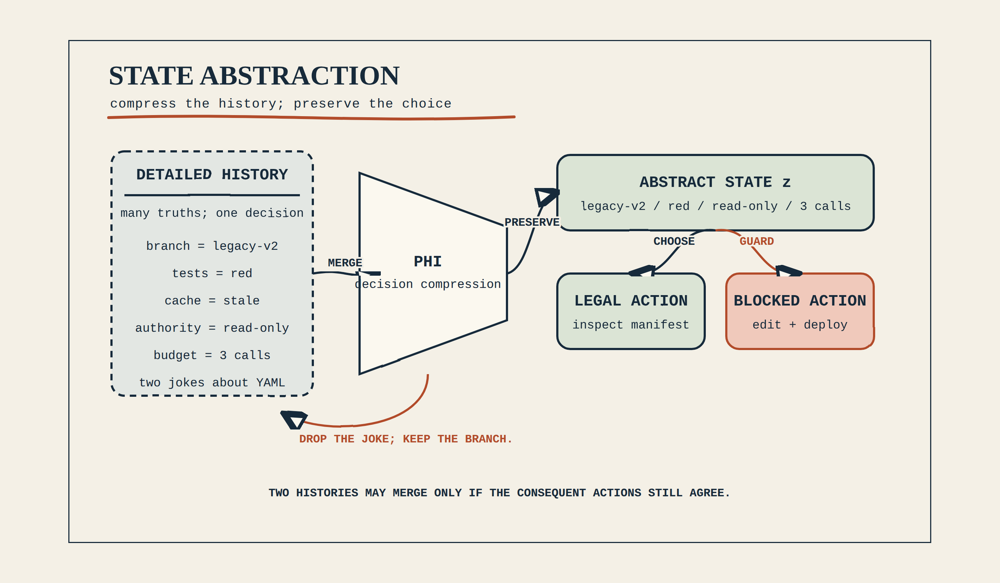

# World Models and State Abstractions

What should an agent carry in its head from one decision to the next? Two ideas answer that question. A **world model** says how the world tends to change. A **state abstraction** says which parts of the past are worth keeping when choosing the next action. Get these wrong and the agent either forgets what it needed or chokes on what it did not.

Belief cannot remain an ever-growing transcript. Newborn Agent-427 has no durable memory at all; within one run, even its temporary history can outgrow the useful decision state. An agent that treats every token as equally available state has not become wise; it has made planning expensive and brittle.

The design problem is selective forgetting. Forget too much and the agent loses the variables that make action competent. Retain too much and the policy drowns in irrelevant distinctions. Good abstraction is compression in service of control.

## From History to Decision State

### The Formal Setup: Compressing a Decision Problem

Compression is easiest to study when nothing else is going wrong, so for a few pages set partial observability aside and pretend the agent can see the full state. The question then becomes sharp: if we merge some of those visible states together, does the agent still choose correctly? Topic 2's hidden-state machinery returns once the answer is clear, because a belief is itself a state that can be compressed.

Let the ground control problem be a **Markov decision process (MDP)**—the fully observed cousin of the POMDP from Topic 1 (Goals, Environments, and Actions)—written as the tuple \((\mathcal S,\mathcal A,T,R,\gamma)\) [[4](../../references.md#ref-4)] [[5](../../references.md#ref-5)]. Read the pieces aloud like this: \(\mathcal S\) is the set of states, \(\mathcal A\) is the set of actions, \(T\) is the transition rule saying which state comes next, \(R\) is the reward, and \(\gamma\) (gamma) is the discount that makes distant rewards count less.

Now let \(\phi:\mathcal S\to\mathcal Z\) map detailed states to abstract states. Read \(\phi\) (phi) as "the compression map that sends a detailed state to its coarser label". Exact **homomorphism** requires reward and transition consistency [[37](../../references.md#ref-37)]:

\[
R(s,a)=\bar R(\phi(s),a),\qquad
\sum_{s':\phi(s')=z'}T(s'\mid s,a)=\bar T(z'\mid \phi(s),a).
\]

> **Try this with numbers.** Step 1: two detailed states both give reward 3 under `install_dependency`, so reward mismatch is 0. Step 2: their probabilities of reaching abstract state \(z_G\) (green) are 0.80 and 0.78, so transition mismatch is 0.02. The four-state example below explains where these numbers come from.

A homomorphism is a structure-preserving map. In ordinary programming terms, \(\phi\) is a compression function. It is allowed to rename and merge states only when the merged states still behave the same way for decisions.

The barred symbols \(\bar R\) and \(\bar T\) live in the abstract world \(\mathcal Z\). So \(\bar T(z'\mid z,a)\) means "the transition probability between abstract states after compression". The sum on the left collects all detailed next states \(s'\) that \(\phi\) maps into the same abstract state \(z'\).



### A Four-State Coding Example You Can Check by Hand

Here is a four-state coding example. Let the detailed states be:

- \(s_1=\) "tests red because dependency missing";
- \(s_2=\) "tests red because dependency missing and cache stale";
- \(s_3=\) "tests red because behavior regressed";
- \(s_4=\) "tests green".

A useful abstraction might map \(\phi(s_1)=\phi(s_2)=z_D\) for dependency trouble, \(\phi(s_3)=z_B\) for behavioral bug, and \(\phi(s_4)=z_G\) for green.

Now check the two conditions with small numbers. Suppose the action `install_dependency` gives reward \(+3\) in both \(s_1\) and \(s_2\), and moves to \(z_G\) with probabilities \(0.80\) and \(0.78\). The rewards match exactly, and the transition probabilities differ by only \(0.02\). Merging \(s_1\) and \(s_2\) therefore approximately preserves reward and transition.

Contrast that with a bad merge. Suppose `edit_logic` gives \(-2\) in \(s_1\) but \(+6\) in \(s_3\). Collapsing \(s_1\) and \(s_3\) into a single `tests_red` state fails action preservation. The same abstract state would recommend incompatible repairs, because the reward gap is \(8\), not \(0\).

### Planning Inside the Compressed Space

Under those assumptions, planning can occur in the compressed space:

\[
\bar V^{*}(z)=\max_{a\in\mathcal A}\Big[\bar R(z,a)+\gamma\sum_{z'}\bar T(z'\mid z,a)\bar V^{*}(z')\Big].
\]

> **Try this with numbers.** Step 1: an action earns 2 and reaches abstract values 6 and 4 with equal probability. Step 2: at \(\gamma=0.5\), its value is \(2+0.5[0.5(6)+0.5(4)]=4.5\).

Read this as: the best long-run value of an abstract state is the best available immediate abstract reward plus the discounted average value of wherever that action lands you. The practical payoff is that the planner never has to look at the full detailed state space.

### What Approximate Abstractions Cost You

The assumptions are strong. Approximate abstractions are more realistic. Their errors should be interpreted as possible value loss rather than as harmless summarization noise. A standard simulation-style bound has the shape

\[
\|V^{*}-\bar V^{*}\!\circ\phi\|_\infty \lesssim \frac{\varepsilon_R}{1-\gamma}+\frac{\gamma R_{\max}}{(1-\gamma)^2}\varepsilon_P,
\]

> **Try this with numbers.** Step 1: with \(\gamma=0.5\), \(\varepsilon_R=0.1\), \(R_{\max}=1\), and \(\varepsilon_P=0.02\), the reward term is \(0.1/0.5=0.2\). Step 2: the transition term is \(0.5(1)(0.02)/0.5^2=0.04\), for a bound scale of \(0.24\).

where \(\varepsilon_R\) and \(\varepsilon_P\) bound reward and transition mismatch [[37](../../references.md#ref-37)] [[39](../../references.md#ref-39)]. The message is practical. Every compressed-away detail is acceptable only if it does not materially change the action the agent should take.

Two pieces of notation deserve a plain reading. The norm \(\|\cdot\|_\infty\), called the **supremum norm** or **sup norm**, means "look at the largest absolute error over all states". The symbol \(\lesssim\) means "bounded up to a conventional constant or omitted technical factor". It is a mathematician's compact way of saying that the right-hand side controls the scale of the left-hand side.

The composition \(\bar V^{*}\!\circ\phi\) means “compress first, then value”:
map the detailed state \(s\) to \(\phi(s)\), then ask the abstract planner for
\(\bar V^{*}(\phi(s))\). The left side therefore compares the original planner
with its compressed counterpart and reports their worst disagreement over
detailed states.

The sup norm is a worst-case check. Suppose compression changes the estimated values of three states by \(+0.1\), \(-0.7\), and \(+0.2\). Ignore the signs, because being \(0.7\) too low is as large an error as being \(0.7\) too high; the absolute errors are \(0.1\), \(0.7\), and \(0.2\). The sup norm reports the largest, \(0.7\). It deliberately lets the most damaged state speak for the whole abstraction, because one badly compressed safety-critical state can matter more than a hundred harmless summaries.

The assumptions behind the bound are doing real work:

- rewards must be bounded by \(R_{\max}\), the largest reward magnitude;
- the discount must satisfy \(\gamma<1\);
- \(\varepsilon_R\) and \(\varepsilon_P\) must genuinely bound the abstraction's reward and transition errors.

Watch the discount term. With \(\gamma=0.9\), the factor \(1/(1-\gamma)^2\) is \(100\). With \(\gamma=0.99\) it is \(10{,}000\). If \(\gamma\) is close to \(1\), small transition errors can echo for a long time. That is why a cheerful summary such as `repo_status: messy` is not enough for high-stakes editing.

## The Assumption

State abstraction assumes that histories merged into one abstract state support the same consequential choices. Exact homomorphism states the ideal; approximate bounds price the deviation. The theorem-shaped promise is conditional: bounded reward, \(\gamma<1\), and honest mismatch bounds. Violate any of them and the displayed value-loss bound no longer licenses the policy. If reward is unbounded or the measured transition error omits a rare release-freeze regime, the arithmetic can be immaculate and irrelevant.

::: {.reader-question}
> **Skeptical Engineer:** “The context window is enormous now. Why not keep everything and let attention sort it out?”
>
> **Author:** Capacity is not relevance, and attention is not a contract [[76](../../references.md#ref-76)]. The policy still needs to know which branch, authority boundary, freshness marker, and unresolved hypothesis controls the next action. A larger attic does not tell the forklift which crate contains the brakes.

:::

## Logs Are Archives; State Is Policy Fuel

### Separating the Audit Trail from the Decision State

A useful implementation separates the raw in-run log from decision state. Agent-427 cannot persist either across runs yet. The code below keeps two in-memory fields: an append-only `event_log` for auditing during the run, and a small `decision_state` that the policy actually reads. Ingestion writes to both; acting reads only the compact one.

```python
from dataclasses import dataclass

@dataclass
class AgentMemory:
    event_log: list[dict]        # audit trail and retrieval source
    decision_state: dict         # compact features used by policy


def ingest(observation: dict, mem: AgentMemory) -> AgentMemory:
    mem.event_log.append(observation)
    evidence = extract_decision_relevant_features(observation)
    mem.decision_state = update_state(mem.decision_state, evidence)
    return mem


def act(mem: AgentMemory):
    return policy(mem.decision_state)
```

For a coding agent, the decision state holds what the next choice actually turns on: the failing behavior and the files already touched, any dependency hints and the current test status, the constraints still in force, the hypotheses not yet ruled out, and how much budget remains. It usually does not need every line of conversation. Raw logs remain available for audit and targeted retrieval. But retrieval should be a gated action with explicit cost, as later memory systems will develop in more detail (see [Memory Systems, Context, and Retrieval](../02-reasoning-architectures/topic-03-memory-systems-context-and-retrieval.md)).

### The Sufficiency Condition That Licenses Forgetting

The formal requirement is conditional sufficiency:

\[
P(s_{t+1},r_t\mid h_t,a_t)=P(s_{t+1},r_t\mid z_t,a_t),\qquad z_t=\psi(h_t).
\]

> **Try this with numbers.** Step 1: suppose full history predicts pass/fail as 0.8/0.2. Step 2: if compressed state predicts the same 0.8/0.2, the one-step discrepancy is 0; if it predicts 0.5/0.5, sufficiency has failed visibly.

Read the left side as "the chance of the next state and this step's reward given the whole history \(h_t\) and the action \(a_t\)". Read the right side the same way, but with the compressed state \(z_t\) in place of the history. The map \(\psi\) (psi) is the summarizer that turns history into that compact state.

This says that, for the next decision, the compressed state \(z_t\) carries the predictive information from history that matters. It does not say the archive is useless. It says the policy should not be forced to plan over the archive unless the current decision needs it.

Action selection can then be interpreted as expected-utility maximization over \(z_t\), provided the abstraction preserves the distinctions that affect utility [[34](../../references.md#ref-34)]. A quick check for builders: if two histories produce the same \(z_t\) but you would want different next actions, the abstraction is already broken.

## The Violation

Agent-427 inspects two publication workspaces. One targets `draft-a`; the other targets `draft-b`. Both have a red citation check. The abstraction `{"checks": "red"}` maps them to one state and deletes the target identifier. A policy asked to inspect the relevant source now cannot choose the correct path. The compression saved perhaps twenty tokens and erased the variable that determines the action.

The opposite failure is contamination by correlation. A trace says that clearing a cache preceded a successful check three times. An abstraction stores `cache_clear_fixes_checks=True` and drops the simultaneous dependency refresh. The summary is compact, predictive on old logs, and causally wrong. When the environment changes, Agent-427 recommends the ritual cache clear with the grave confidence of a machine that has mistaken coincidence for physics.[^attic]

Because Agent-427 has no durable memory, neither state survives a restart. That limitation is explicit. Chapter 2 will add memory and inherit the harder obligation to preserve provenance and version across time.

## When It Fails

The sufficiency equation is falsifiable. Find two histories that map to the same \(z_t\), hold the proposed action fixed, and compare next-state or reward distributions. In the workspace example, `inspect draft-a` is useful in one history and wrong in the other. The equality fails, so the summarizer must restore `target_workspace` or force a fresh inspection before acting.

Approximation bounds fail more quietly. If tests cover common states but omit the release-freeze tail, measured \(\varepsilon_P\) can look tiny while the actual policy changes exactly when the stakes rise. The repair is stratified evaluation: measure action preservation and value loss across task regimes, especially rare ones, and include an `unknown` state that makes missing distinctions visible rather than silently defaulting them.

[^attic]: “We have always cleared the cache” is not a causal model. It is an origin myth with a shell command.

## Behavioral and Causal Fidelity

### Measuring "Close Enough" with Bisimulation Distance

Bisimulation metrics sharpen the idea of "close enough" by measuring whether two states behave similarly under action [[38](../../references.md#ref-38)]. A **bisimulation** asks whether two states can answer the same action questions. Do they give similar immediate rewards? Do they lead to similar distributions over future states? The distance below adds those two differences, taking the worst action:

\[
d(s,s')=\max_{a\in\mathcal A}\Big(|R(s,a)-R(s',a)|+\gamma\,W_d\big(T(\cdot\mid s,a),T(\cdot\mid s',a)\big)\Big),
\]

> **Try this with numbers.** Step 1: let reward difference be 2 and lifted transition distance be 0.4. Step 2: with \(\gamma=0.5\), the action contributes \(2+0.5(0.4)=2.2\) to the distance.

The first term checks reward. The second compares transition distributions using \(W_d\), the **Kantorovich lifting**, which turns a distance between single states into a distance between probability distributions over states. Intuitively, it asks how much "work" is needed to transport probability mass from one next-state distribution to the other, when moving mass between unlike states is expensive. Notice that \(d\) appears on both sides: the distance between states is defined using distances between their successors, the same self-reference that powers Bellman recursion.

If \(d(s,s')\) is small, the states are interchangeable up to a quantified tolerance. If "test failed because dependency missing" and "test failed because behavior regressed" collapse into the same feature `tests_red`, the abstraction may be compact, but it is not behaviorally faithful.

The exact transport machinery can wait; the engineering lesson cannot. If two situations lead to different repair actions, their distance should not be treated as zero merely because the same red test banner appears.

### Why Acting Agents Need Causal Models, Not Just Correlations

Agents also need causal fidelity when they intervene. A causal world model encodes mechanisms rather than only associations [[6](../../references.md#ref-6)]:

\[
X_i=f_i(\mathrm{Pa}(X_i),U_i),\qquad P(x_1,\dots,x_n)=\prod_i P(x_i\mid \mathrm{pa}_i).
\]

> **Try this with numbers.** Step 1: let a binary parent occur with probability 0.5 and its child with conditional probability 0.8. Step 2: that joint assignment has probability \(0.5\times0.8=0.4\).

Intervention semantics replace observation with action:

\[
P(x_1,\dots,x_n\mid \mathrm{do}(X_j=x))=\mathbf{1}[x_j=x]\prod_{i\neq j}P(x_i\mid \mathrm{pa}_i).
\]

> **Try this with numbers.** Step 1: intervene so \(X_j=x\), making the indicator 1. Step 2: if the two remaining conditional factors are 0.6 and 0.5, the interventional assignment has probability \(1\times0.6\times0.5=0.3\).

These are **structural causal equations**. Each variable \(X_i\) is produced by a function \(f_i\) of its parents \(\mathrm{Pa}(X_i)\) and background disturbance \(U_i\). Read \(\mathrm{Pa}(X_i)\) as "the parents of \(X_i\)", meaning the variables that directly cause it. The product factorization says the joint probability can be assembled from each variable given its parents.

The notation \(\mathrm{do}(X_j=x)\) means an intervention: set \(X_j\) to \(x\) by action, rather than merely observing that it happened to equal \(x\). The indicator \(\mathbf{1}[x_j=x]\) reads "one when \(x_j\) equals \(x\), zero otherwise", which is how the equation records that the intervened variable no longer listens to its parents. In code-agent language, observing that "tests pass after a cache clear" is not the same as knowing that clearing the cache caused the pass. Perhaps the dependency install was the real mechanism.

Picture two identical sandbox copies. In the first, Agent-427 merely watches a cache clear happen alongside a dependency refresh. In the second, it deliberately clears the cache while holding the dependency state fixed. The ordinary conditional probability describes the first scene: what tends to be seen together. The \(do\) expression describes the second: force one variable to a chosen value, cut the usual causes feeding into it, and watch what changes downstream. Causal claims require the second kind of comparison, or assumptions strong enough to stand in for it.

That distinction matters for agents because they do not merely predict. They edit files, send messages, allocate resources, and call tools. "This change correlated with lower latency" is weaker than "raising worker count lowers queue latency after a delay and raises cost".

A state abstraction that erases the difference between correlation and intervention will mislead control. Feedback laws such as \(u_t=-K\hat x_t\) are a reminder of the point. Read that as "the control input at time \(t\) is minus a gain matrix \(K\) times the estimated state \(\hat x_t\)". The estimated state is not a report for its own sake; it is the input to correction [[36](../../references.md#ref-36)] [[41](../../references.md#ref-41)].

## Studying Abstractions

### Good Compression Depends on the Task

Evaluate abstractions by downstream behavior. The quality of a compression is task-dependent, because different tasks preserve different distinctions.

- A customer-support agent may need order status, policy version, and jurisdiction, while safely ignoring the poetic texture of the complaint.
- A coding agent may need failing behavior, touched files, dependency state, and test scope, while ignoring most pleasantries in the transcript.
- A summarizer may compress away execution permissions that a deployment agent must keep in letters ten feet high.

### Five Measurements Worth Taking

Suppose someone hands you a candidate summarizer for Agent-427 and claims it is good. Five measurements, each answering a different skeptical question, will tell you whether to believe them.

The first question is *how much does compression cost in value?* Measure **value loss**, \(\Delta_V=\|V^{*}-\tilde V^{*}\circ\phi\|_\infty\), read as "the largest gap, over all states, between true optimal value and the abstract value pulled back through \(\phi\)". Estimate it by scoring the abstract policy in the detailed environment. A close cousin asks *do merged states still want the same action?* **Action preservation** checks, state pair by state pair, whether everything mapped to the same \(z\) really supports the same choice; the `draft-a`/`draft-b` merge fails this test on its first pair.

The third question is causal: *does the abstraction predict what happens when the agent intervenes, not just what it observes?* Measure **intervention fidelity** by taking the action deliberately—clear the cache while holding dependencies fixed—and comparing outcome to prediction. The fourth asks *does the summary survive a different world?* **Robustness under distribution shift**—a change between the situations the abstraction was designed on and the ones it now meets—is measured by rerunning the same tasks with a tighter retrieval budget and watching how fast value loss grows.

Only then comes the question that motivated compression in the first place: *what did it save?* Report **token and latency savings**—context size, model time, retrieval work, tool waiting—but always next to the first four numbers. Savings bought by erasing a decision-relevant variable are not savings; they are a loan against the next incident.

The interpreter now has a compact internal language: a state small enough to act on but faithful enough to trust. What it still lacks is the nerve to use it. Every example in this topic ended with "the policy should choose..." and quietly assumed some policy existed. Agent-427 will soon face two read-only proposals with different payoffs, a reviewer whose preferences it must learn, and logs from a predecessor whose choices it cannot replay. Choosing well under those pressures—weighing futures, learning from feedback, and never exceeding granted authority—is the subject of Topic 4 (Policies, Value, and Control).

::: {.exercise}
## Exercise: Break Two Summarizers {.unnumbered}

Implement two Python functions over synthetic agent traces. `last_n_tokens(history, n)` keeps a fixed suffix. `decision_state(history)` extracts target workspace, check status, evidence freshness, permissions, unresolved hypotheses, and remaining budget. Generate at least 1,000 seeded traces in which the decisive target or permission appears early, while later log noise is longer than the suffix budget.

For each abstraction, measure token count, action-preservation rate, and realized value under a reference policy that sees full history. Add a second dataset where cache clearing correlates with success but dependency refresh is the true intervention. Your test must demonstrate one state pair with distance zero under the naive abstraction but different optimal actions, then repair the abstraction until the pair separates. No prose-only victory conditions: submit the generator, assertions, and a table of measured failures.

:::
