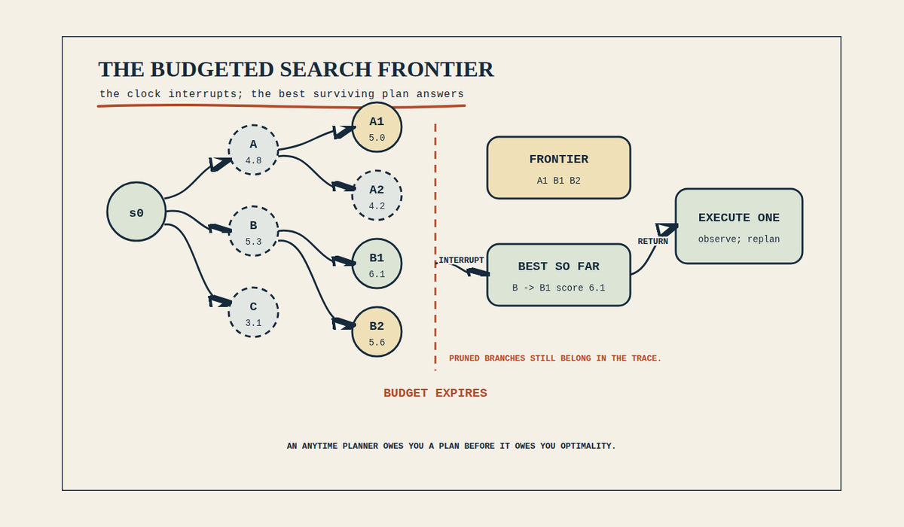

# Deliberation, Planning, and Search

At 3:47:25 AM, Agent-427 has survived its first illegal import. It now possesses a safer tool, `inspect_file`, and a choice: inspect the authentication code immediately, or spend scarce seconds imagining what it might find. A proposal says “open this file.” A plan says “open this file, expect this evidence, and do this if the evidence laughs at us.”

Deliberation is the wager that simulated futures will save more than they cost. Search operationalizes the wager. Planning gives the selected future preconditions, expected observations, costs, risks, and contingencies. The difficulty is that reality continues running while the planner enjoys its miniature theatre.

## Plans as Paths, Not Prophecies

Let \(G=(V,E)\) be a search graph. Vertices are decision states and edges are legal transitions. A deterministic plan \(p=(v_0,\ldots,v_T)\) is a path whose cost is

\[
J(p)=\sum_{t=0}^{T-1}c(v_t,v_{t+1})+\Phi(v_T).
\]

> **Try this with numbers.** Step 1: price three moves at 2, 1, and 4, then assign terminal penalty 3. Step 2: compute \(J=2+1+4+3=10\); a two-step plan costing 8 with penalty 1 wins at 9.

The step cost \(c\) may combine tokens, latency, money, and risk. The terminal penalty \(\Phi\) prices the state in which the plan abandons the agent. “Tests still red but root cause localized” deserves a different penalty from “repository edited and no tests run.”

A* ranks candidate nodes by

\[
f(n)=g(n)+h(n).
\]

> **Try this with numbers.** Step 1: candidate A has \(g=2,h=5\), so \(f=7\). Step 2: candidate B has \(g=4,h=1\), so \(f=5\); expand B first despite its dearer history.

Here \(g\) is cost already paid and \(h\) is estimated remaining cost. If \(h(n)\le h^\star(n)\), the heuristic is admissible and supports shortest-path guarantees under the usual graph assumptions [[8](../../references.md#ref-8)]. It may be ignorant. It may not be boastful.

The branching factor counts successor choices. Ten plausible next actions over depth five yield \(10^5=100{,}000\) naive action sequences; three well-typed actions yield \(3^5=243\). Constrained action generation is therefore not merely syntax hygiene. It reshapes the search geometry.

## The Assumption

Planning assumes that the search state preserves what future actions need, that transitions remain useful approximations during deliberation, and that heuristic scores compare candidates in the world where execution will occur. Symbolic planning makes the first bargain explicit:

\[
s_{t+1}=(s_t\mathbin{\backslash}\mathrm{Del}(a_t))\cup\mathrm{Add}(a_t),
\qquad \mathrm{Pre}(a_t)\subseteq s_t.
\]

> **Try this with numbers.** Step 1: let state contain 4 facts, delete 1 stale fact, and add 2 fresh facts. Step 2: the next state has \(4-1+2=5\) facts, provided every precondition was among the original 4.

The planner may represent a hypothetical `run_tests` node with this toy contract:

\[
\mathrm{Pre}(\texttt{run\_tests})=
\{\texttt{deps\_installed},\texttt{worktree\_readable}\}.
\]

> **Try this with numbers.** Step 1: satisfy 2 of 2 preconditions and the action is legal. Step 2: satisfy only 1 of 2 and legality is false; ninety-nine percent readiness remains zero percent authorization.

Its effects are

\[
\mathrm{Add}(\texttt{run\_tests})=\{\texttt{test\_result\_known}\},
\qquad
\mathrm{Del}(\texttt{run\_tests})=\{\texttt{test\_result\_stale}\}.
\]

> **Try this with numbers.** Step 1: begin with one stale-result fact. Step 2: delete that fact and add one known-result fact; the fact count stays 1 while its epistemic quality changes completely.

This is STRIPS-style set editing: preconditions say what must already be true, add effects say what becomes true, and delete effects say what must no longer be trusted [[9](../../references.md#ref-9)] [[10](../../references.md#ref-10)]. In Chapter 2, however, `run_tests`, patching, and suite execution remain **simulated planner actions**, not executable tools. Agent-427 can execute only `inspect_file`; its authority guard rejects patch and test proposals. Chapter 3 will grant effectful proposals behind contracts. A future deployment plan may require passing tests, approval, a rollback handle, and a version-fresh target. Hope is not a dependency manager.

::: {.reader-question}
> **Skeptical Engineer:** Doesn't a language model infer these preconditions anyway?
>
> **Author:** Sometimes. It also inferred a module that did not exist. We write preconditions down because “usually remembered by a stochastic process” is not the same type as `bool`.

:::

## The Violation

At 3:47:28, Agent-427 builds a sensible four-step plan against the world it observed. Then the world changes while the plan is still thinking:

```text
03:47:28 observe  auth service reports API v2; replica A serves config epoch 81
03:47:31 plan     inspect verifier -> [simulate patch] -> [simulate test] -> [simulate suite]
03:47:44 search   prefer v2 adapter branch; estimated cost 7
03:47:51 world    replica B promotes API v3; config epoch becomes 82
03:47:56 act      inspect v2 adapter on replica A; finds deprecated field
03:48:01 simulate model predicts replica B would reject deprecated field
03:48:04 replan   propose removing field for v3
03:48:09 guard    reject patch/test proposals: inspect_file is the only executable tool
03:48:13 replan   restore v2 hypothesis; request authority or hand off
```

The agent's **proposed plans** oscillate because its hidden model contains one stationary “auth service,” while production contains asynchronously replicated versions. Its guard prevents those proposals from becoming edits or test executions. The world changed while it thought; worse, different observations sampled different worlds. A plan versioned only by task is under-specified. It also needs observation time, target identity, configuration epoch, and an invalidation policy. Meta-learning can train fast adaptation across task distributions, but it does not excuse a runtime from observing which distribution has arrived [[74](../../references.md#ref-74)].

Expected utility still ranks candidates:

\[
a_t^\star=\arg\max_a\mathbb{E}[U(a,S_t)\mid h_t].
\]

> **Try this with numbers.** Step 1: an immediate inspection is worth 6; a two-second search promises 9 but costs 1, yielding 8. Step 2: if a 0.5 probability of version drift imposes loss 6, its drift-adjusted value is \(8-0.5\times6=5\); inspect now.

The violation is not “expected utility failed.” The expectation omitted a relevant event: model expiry during deliberation [[33](../../references.md#ref-33)] [[34](../../references.md#ref-34)]. Non-stationarity belongs in the state and transition model, or in robust uncertainty around them.

For stochastic outcomes, Bellman recursion writes the long-horizon bargain:

\[
V^\star(s)=\max_a\left\{R(s,a)+\gamma\sum_{s'}P(s'\mid s,a)V^\star(s')\right\}.
\]

> **Try this with numbers.** Step 1: an action earns 2 now and reaches values 10 and 4 with probabilities 0.7 and 0.3, so expected successor value is \(8.2\). Step 2: with \(\gamma=0.9\), total value is \(2+0.9\times8.2=9.38\).

In partial observability the recursion runs over belief, not omniscient state [[5](../../references.md#ref-5)] [[4](../../references.md#ref-4)] [[7](../../references.md#ref-7)]. In non-stationary production, the belief should include model/version hypotheses or change points. Otherwise \(P\) describes the museum exhibit while the live API rearranges the furniture.

## Spending Simulations Under a Clock

After expanding every unvisited action once, Monte Carlo tree search allocates
further rollouts with an optimism bonus:

\[
a^\star=\arg\max_{a:\,N(s,a)>0}\left(
Q(s,a)+c\sqrt{\frac{\ln N(s)}{N(s,a)}}
\right).
\]

> **Try this with numbers.** Step 1: let \(Q=4\), \(c=1\), parent visits \(N(s)=100\), and action visits \(N(s,a)=4\); the bonus is about \(\sqrt{4.605/4}=1.07\). Step 2: the selection score is about 5.07; after 40 action visits the bonus falls to about 0.34.

Here \(Q(s,a)\) is the average value observed after trying action \(a\) from state
\(s\); \(N(s)\) counts visits to the state, and \(N(s,a)\) counts trials of that
action. The constant \(c\) sets the appetite for exploration. The square-root
term is an uncertainty allowance: it is large for neglected branches and
shrinks as evidence accumulates. Agent-427 spends some rollouts to remain
correctable.

A tree-search implementation can keep two columns beside every tried action. The first column, \(Q\), is “how well this branch has done so far.” The second is a curiosity allowance. A branch tried only four times receives a larger allowance than one tried forty times, because little evidence exists about it. Add the columns and inspect the largest total. As visits accumulate, the denominator grows and curiosity fades; the branch must eventually survive on results rather than novelty. Actions with no visits are handled first, before this division is used.

Rollouts trade exploitation of promising branches against exploration of neglected ones [[45](../../references.md#ref-45)]. Under change, timestamps matter: a thousand rollouts through yesterday's model are a beautifully estimated obsolete policy.

Anytime planning returns its best available candidate when interrupted [[44](../../references.md#ref-44)].



Receding-horizon control goes farther: optimize several steps, execute one, observe, and solve again:

\[
\mathbf{u}_{t:t+H-1}^{\star}
=\arg\min_{\mathbf{u}_{t:t+H-1}}
\sum_{k=0}^{H-1}\ell(x_{t+k},u_{t+k})+\ell_f(x_{t+H}),
\]

> **Try this with numbers.** Step 1: for horizon 2, candidate A has step costs 2 and 3 plus terminal cost 1, totaling 6. Step 2: candidate B totals \(1+2+2=5\); choose B, execute only its first action, then measure again.

subject to \(x_{t+k+1}=F(x_{t+k},u_{t+k})\) and
\(g(x_{t+k},u_{t+k})\le0\) for \(k=0,\ldots,H-1\). The optimizer reasons
over a sequence; the agent executes only the first component before feedback
revises the problem [[41](../../references.md#ref-41)].

Read \(\mathbf{u}_{t:t+H-1}\) as a proposed sequence of \(H\) controls beginning
now. Each \(\ell\) charges for one step, \(\ell_f\) charges for the state left at
the horizon, \(F\) predicts the next state, and \(g\le0\) marks the admissible
region. The star crowns the cheapest legal imagined sequence; only its first
action inherits a chance to meet reality.

```text
function RECEDING_HORIZON_STEP(sigma, horizon, budget):
    candidates <- search(sigma, horizon, budget)
    plan <- argmax_expected_utility(candidates)
    a0 <- first_action(plan)

    require plan.observation_epoch == current_epoch(a0.target)
    if not legal(a0, sigma):
        return fallback_or_clarify(sigma)

    require a0.name == "inspect_file"  # Chapter 2 authority boundary
    sigma_next <- execute(a0, sigma)
    return observe_and_replan(sigma_next)
```

The epoch guard turns “the world might have changed” into an executable invalidation rule.

## When It Fails

Planning fails when decomposition hides coupling, heuristics reward easily measured progress, or stale models produce precise nonsense. An adversarial API can exploit this by returning a cheap successful probe while reserving failure for the irreversible call. The planner learns “endpoint healthy” from the probe and spends its authority on a state the probe never represented.

Reflection can repair a hard plan after contradictory evidence, but it can also tax a trivial task into insolvency. Planning earns its keep when horizon, branching, prerequisites, uncertainty, or irreversibility create genuine geometry. A one-line formatting fix does not need an opera.[^planner-opera]

[^planner-opera]: The overture alone consumed 1,800 tokens and the variable is still misspelled.

Every candidate trajectory should record state estimate, state/version age, action, expected observation, cost, risk, and contingency. Log pruning decisions when they affect safety. Put symbolic preconditions around irreversible actions. Trigger replanning on new evidence, failed preconditions, budget drift, tool errors, observation expiry, or a value change that reorders the frontier.

::: {.exercise}
## Exercise: Make the World Betray Your Planner {.unnumbered}

Implement a small planner and a changing environment.

1. Model two API replicas, versions v2 and v3, with asynchronously changing epochs and incompatible preconditions.
2. Implement A* over at least 20 states, then wrap it in a receding-horizon controller that executes one action per observation. The real adapter must expose only `inspect_file`; patch and test nodes remain simulations.
3. Run 1,000 seeded episodes. Halfway through 30% of them, change one replica's version while the planner is searching.
4. Compare three policies: execute the full original plan, replan after every action, and replan only when an epoch guard fails.
5. Assert that patch/test adapters receive zero calls. Report success, oscillation count, planning latency, actions per repair, and unsafe/invalid proposals. Then introduce an API that lies on probes but would fail on commits, and patch one simulated precondition to detect it.

Your result must include code, tests for the version race, and a table of measurements. A hand-drawn plan receives partial credit only if it can also hand-draw a stack trace.

:::
