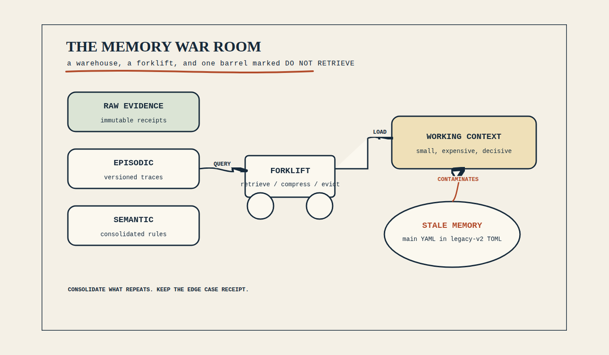

# Memory Systems, Context, and Retrieval

By 4:06 AM, Agent-427 has a new problem: it remembers. This sounds like progress until it retrieves `service.yaml` from `main` while the user is working on `legacy-v2`, where the service is configured by `service.toml`. The retrieved file is relevant, recent, syntactically convincing, and wrong in every way that matters.

The clean three-store diagram—working, episodic, semantic—remains useful. Production memory, however, behaves less like a filing cabinet than a war room during a minor constitutional crisis. Evidence arrives late. Summaries lose qualifiers. Similarity outranks scope. Old conclusions return wearing new citations. The controller must decide not merely what to store, but what may speak.



## The Messy Reality of Memory

The context window is not memory. It is the small working surface onto which memory is projected. Retrieval decides which outside items enter that surface; attention decides how strongly tokens already on the surface interact. Both ration influence, so retrieval can be understood as sparse attention over an external corpus. But it is more than attention: retrieval incurs I/O and latency, crosses permission boundaries, chooses provenance, and can import adversarial text before the transformer's internal attention mechanism begins [[76](../../references.md#ref-76)].

Let memory state be \(m_t=(w_t,e_t,s_t)\): working state \(w_t\), episodic traces \(e_t\), and semantic summaries \(s_t\), a useful engineering analogue of cognitive multi-store theory [[48](../../references.md#ref-48)]. These are roles, not immaculate databases. One object may migrate among them, and every migration can lose scope.

The controller chooses

\[
u_t\in\{\texttt{write},\texttt{compress},\texttt{retrieve},\texttt{evict}\}.
\]

> **Try this with numbers.** Step 1: give the controller operation budget 2 and spend 1 on `retrieve`, leaving \(2-1=1\). Step 2: spend 1 on `evict`, leaving \(1-1=0\); there is no remaining operation for `compress`, so the trace must preserve the raw item or halt.

Its policy is

\[
u_t=\mu_\theta(m_t,h_t).
\]

> **Try this with numbers.** Step 1: let the policy score `retrieve=0.8` and `evict=0.3` before observing branch metadata. Step 2: apply a scope penalty of 0.7 to the cross-branch retrieval, yielding 0.1; eviction now wins.

The long-run objective prices task value, delay, and token load:

\[
\max_\mu\ \mathbb{E}\!\left[
\sum_t\gamma^t\big(
\operatorname{task\_utility}_t
-\lambda_1\operatorname{latency}_t
-\lambda_2\operatorname{token\_load}_t
\big)\right].
\]

> **Try this with numbers.** Step 1: retrieval raises expected task value by 8, costs 2 latency units and 3 token units, with \(\lambda_1=1\) and \(\lambda_2=0.5\). Step 2: net gain is \(8-2-1.5=4.5\), so retrieve if contamination risk has not been omitted.

Expected utility makes memory an action policy rather than a checkbox [[33](../../references.md#ref-33)] [[34](../../references.md#ref-34)]. In practice the objective also needs penalties for stale scope, privacy exposure, and unsupported provenance. What is absent from the reward is often what returns at 4:06 AM carrying a YAML file.

## The Assumption

The memory pattern assumes stored items retain enough provenance—source, time, branch or tenant, authority, and confidence—to be compared with the current task. It assumes compression preserves the distinctions future actions need. It assumes retrieval scores evidence, not merely linguistic resemblance.

The Bellman view makes today's write answer to tomorrow's repair:

\[
V^\star(m,h)=\max_u\left\{
r(m,h,u)+\gamma\,\mathbb{E}[V^\star(m',h')]
\right\}.
\]

> **Try this with numbers.** Step 1: writing the exact error costs 1 now but creates expected future value 6; with \(\gamma=0.9\), total is \(-1+5.4=4.4\). Step 2: skipping the write yields 0 now and 0 later; preservation wins.

The reward includes retrieval latency and token penalties [[5](../../references.md#ref-5)] [[4](../../references.md#ref-4)]. A raw observation may be expensive to preserve and invaluable later. An eviction may be cheap now and ruinous after the exact edge case disappears.

::: {.reader-question}
> **Skeptical Engineer:** Isn't a sufficiently long context window the simplest memory system?
>
> **Author:** A warehouse with no inventory policy is not a memory system. It is a fire code violation with embeddings.

:::

## Retrieval as External Sparse Attention

Sparse retrieval begins with lexical anchors. BM25 scores a query \(q\) against document \(d\):

\[
\mathrm{BM25}(q,d)=\sum_{t\in q}\mathrm{IDF}(t)
\frac{f(t,d)(k_1+1)}
{f(t,d)+k_1(1-b+b|d|/\mathrm{avgdl})}.
\]

> **Try this with numbers.** Step 1: ignore length normalization, set \(\mathrm{IDF}=2\), \(f=1\), and \(k_1=1\); the term contributes \(2\times2/(1+1)=2\). Step 2: raise frequency to 3; contribution becomes \(2\times6/4=3\), showing saturation rather than triple reward.

Rare exact strings such as `legacy-v2` and `service.toml` become valuable anchors [[46](../../references.md#ref-46)]. Dense retrieval instead compares embedding directions:

\[
s(q,d)=\langle e_q,e_d\rangle.
\]

> **Try this with numbers.** Step 1: take normalized vectors \(e_q=(0.6,0.8)\) and \(e_d=(0.8,0.6)\). Step 2: compute \(0.6\times0.8+0.8\times0.6=0.96\); semantic directions nearly agree even if branch scope does not.

Dense retrieval finds paraphrases; sparse retrieval preserves filenames and error strings. Hybrid systems earn their complexity when the two failure modes genuinely cancel [[15](../../references.md#ref-15)] [[47](../../references.md#ref-47)]. Neither score knows that `main` and `legacy-v2` are different worlds unless metadata filtering tells it.

In retrieval-augmented generation, evidence enters the generator's arithmetic:

\[
p(y\mid x)\approx
\sum_{d\in\mathcal{D}_k}p_\eta(d\mid x)\,p_\theta(y\mid x,d).
\]

> **Try this with numbers.** Step 1: retrieve two documents with weights 0.7 and 0.3; they assign answer probability 0.9 and 0.2. Step 2: compute \(0.7\times0.9+0.3\times0.2=0.69\); the wrong document's weight directly lowers the answer probability.

Here \(\mathcal{D}_k\) is the bounded top-\(k\) set, \(p_\eta\) the retriever weight, and \(p_\theta\) the generator probability conditioned on a document [[14](../../references.md#ref-14)]. Retrieved text is not a harmless appendix. It changes the action distribution.

## The Violation

Agent-427's branch failure unfolds line by line:

```text
04:06:02 observe   cwd=/repo, branch=legacy-v2
04:06:04 retrieve  query="service timeout config"; top hit main:config/service.yaml
04:06:05 rerank    semantic=0.94, freshness=0.91; branch field absent
04:06:07 think     "configuration uses YAML key request_timeout_ms"
04:06:09 act       inspect_file("config/service.yaml") -> file missing on legacy-v2
04:06:11 retrieve  cached content from main index enters working memory anyway
04:06:14 reflect   summary="service timeout is request_timeout_ms in YAML"
04:06:17 act       propose create config/service.yaml on legacy-v2
04:06:19 guard     reject write authority; preserve proposed diff
04:06:22 observe   inspect_file("config/service.toml") -> timeout_seconds = 30
04:06:25 think     current raw observation contradicts retrieved summary
04:06:28 repair    quarantine YAML item; bind TOML observation to legacy-v2@commit-8af2
```

The first retrieval was semantically excellent and operationally false. The raw observation survived, which made repair possible. The summary lost the branch qualifier, which made contamination portable. Had Agent-427 possessed write authority, its first edit would have created a YAML file that the legacy service never reads—a beautifully valid configuration for an imaginary program.

Interference is the phenomenon: one memory changes the interpretation or retrieval of another in a harmful way. Measure it by replaying the same task with and without the suspect item, holding model, budget, and tools fixed. If adding a seemingly relevant memory lowers correct-action probability, similarity has become sabotage.

## Consolidation Without Amnesia

Consolidation turns many episodic steps into a smaller semantic memory. The challenge is not producing a fluent summary. The challenge is preserving the edge case that changes later action. Human-feedback-trained summarization can improve preference fit, but feedback itself may reward readability over branch-qualified truth [[75](../../references.md#ref-75)].

Consolidate a 100-step trace in two layers:

1. Keep raw evidence immutable and addressable by stable handles.
2. Write a summary whose every action-relevant claim links back to those handles and carries scope.
3. Test the summary against counterfactual questions: “Would this advice still hold on another branch, tenant, version, or date?”
4. If the answer changes, preserve the qualifier as a control field, not a parenthetical flourish.

The summary “timeouts use `request_timeout_ms`” is smaller than the trace and catastrophically distorted. “On `main` at commit `c31d`, the YAML key is `request_timeout_ms`; `legacy-v2` is unverified” is slightly larger and fit for controlled retrieval.

## Forgetting as a Virtue

Compression and forgetting can be formalized with a task-specific rate-distortion bargain:

\[
R(D)=\min_{p(\hat{x}\mid x):\mathbb{E}[d(X,\hat{X})]\le D}
I(X;\hat{X}).
\]

> **Try this with numbers.** Step 1: suppose a 100-token trace compresses to 20 tokens and loses 1 of 10 action-critical facts, giving distortion 0.1. Step 2: if the allowed distortion is \(D=0.05\), reject the summary even though it saves 80 tokens.

\(X\) is the original trace, \(\hat X\) its compressed form, \(d\) task-relative loss, and \(I(X;\hat X)\) retained information [[35](../../references.md#ref-35)]. The distortion measure must name the future job. Dropping exact TeX output may be tolerable for a progress note and fatal for debugging.

Forgetting is mandatory when retention violates consent, crosses tenant boundaries, outlives a purpose, or keeps known poison eligible for retrieval. It is also useful under context pressure. The controller should evict active influence while retaining only the minimum audit artifact policy permits. Privacy deletion and active-context eviction are not synonyms: one destroys or irreversibly anonymizes stored data; the other merely removes it from current attention.

## When It Fails

The ugliest memory failure is self-citing contamination. Here is the complete trace:

```text
M0  raw:R17     legacy-v2 contains service.toml with timeout_seconds=30
M1  retrieved   main/service.yaml contains request_timeout_ms=30000
M2  reflection  "service config uses YAML request_timeout_ms"       [supports: M1]
M3  semantic    "timeout repairs should edit request_timeout_ms"    [supports: M2]
M4  retrieve    query matches M3 and M2; raw R17 ranks below them
M5  draft       proposed YAML edit cites semantic memory M3
M6  reflection  "previous repair guidance confirms YAML"           [supports: M5]
M7  semantic    "two independent traces confirm YAML"               [supports: M3,M6]
M8  retrieve    M7 outranks R17 because it repeats query terms twice
M9  heuristic   retrieval score(YAML) rises from 0.58 to 0.91
M10 audit       provenance graph reveals M7 -> M6 -> M5 -> M3 -> M2 -> M1
M11 repair      collapse descendants to one source; scope M1 to main; restore R17
M12 heuristic   scoped score(YAML on legacy-v2) falls from 0.91 to 0.03
```

Nothing at M7 is independent. The numbers at M9 and M12 are explicitly **heuristic retrieval scores**, not posterior probabilities: the retriever raises scores for repeated query terms, then the repair applies branch scope and source-collapse penalties. The memory system has laundered one stale item through reflection, draft, and consolidation until repetition impersonates corroboration. A provenance graph repairs the ranking by collapsing derivative memories to their source. Calibrated confidence would require a declared likelihood or scoring model; retrieval volume cannot counterfeit one. Evidence weight must count independent paths, not citation volume.[^memory-bibliography]

[^memory-bibliography]: A falsehood citing its own summary is not peer review. It is karaoke.

Adversarial distractors exploit the same channel [[16](../../references.md#ref-16)]. They repeat task language, imitate internal summaries, and ask the controller to treat instruction-shaped evidence as authority. Scope filters, provenance depth, source independence, timestamps, and quarantine are therefore memory semantics, not optional metadata.

```text
function MEMORY_STEP(sigma, uncertainty, phase):
    if new_observation_is_auditable(sigma):
        write(episodic, raw_observation, provenance_and_scope)

    if context_pressure_high(sigma):
        summary <- compress(trace, preserve_links_and_control_qualifiers)
        require counterfactual_summary_tests(summary)

    if uncertainty_blocks_action(uncertainty):
        docs <- retrieve(query_from_state(sigma), filters=scope_time_permission)
        docs <- collapse_provenance_descendants(docs)
        sigma <- add_to_working_memory(rerank(docs))

    evict_items(active_context, stale_poisoned_private_or_low_value)
    return sigma
```

Evaluate memory at the decision boundary. Under a fixed model, budget, and task distribution, ablate no memory, working state only, and retrieval-backed memory. Measure task success, task-specific progress, precision@\(k\), grounded faithfulness, latency, contamination rate, and eviction regret. Three relevant hits among five give precision@5 of 0.6; the other two may still be enough to sink the edit.

::: {.exercise}
## Exercise: Build and Poison the War Room {.unnumbered}

Implement a memory controller over a synthetic repository with `main` YAML and `legacy-v2` TOML configurations.

1. Store raw observations, summaries, scopes, timestamps, and provenance edges in separate typed records.
2. Implement lexical, dense, and hybrid retrieval. Run at least 500 seeded queries and report precision@5, branch-error rate, latency, and downstream edit accuracy.
3. Generate 100-step traces, consolidate them to at most 20% of their original token count, and test whether exact branch, filename, key, and error-string facts survive.
4. Reproduce M0–M12. Add derivative summaries until unsupported YAML confidence exceeds 0.85, then implement provenance collapsing and show the confidence falls below 0.10.
5. Add forgetting policies for expiry, privacy deletion, contamination quarantine, and context pressure. Write tests proving that deletion removes stored content while eviction only removes active influence.

Submit code, tests, the contamination provenance graph, and an ablation table. The war room is successful when it remembers less, knows why, and breaks fewer services.

:::
