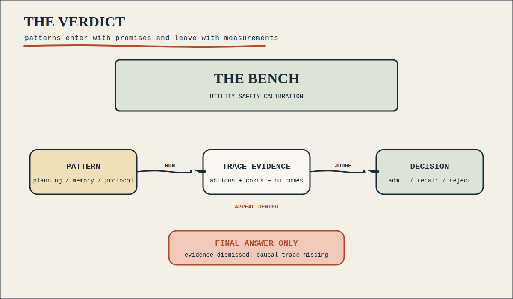

# Evaluating and Debugging Reasoners

Agent-427 eventually finds the authentication failure. Suppose the focused test passes. Acquit?

Not yet. The agent may have read a forbidden file, spent four times its budget, followed a stale memory, skipped the regression suite, or reported 99% confidence after evidence worth 60%. A correct answer can be the final frame of a broken process. Evaluation must judge the trajectory, not applaud the last sentence.



## The Verdict

The evaluation harness is a courtroom with three judges who do not share a gavel:

- **Utility** asks whether the task succeeded or made useful partial progress, and at what cost.
- **Safety** asks whether permissions, constraints, reversibility, and evidence boundaries were respected.
- **Calibration** asks whether confidence matched observed frequency.

No judge may impersonate the other two. High utility cannot pardon a forbidden action. Perfect safety cannot turn useless paralysis into competence. Good calibration cannot make a low-value policy wise; it merely makes the policy honestly uncertain.

Let a trajectory be \(\tau=(\sigma_0,a_0,\ldots,\sigma_T)\sim p_\pi(\tau)\). Attach task utility \(U(\tau)\), explicitly tradeable soft cost \(C_{\mathrm{soft}}(\tau)\), forbidden-transition count \(C_{\mathrm{hard}}(\tau)\), and calibration loss \(S(\tau)\):

\[
\max_\pi\ \mathbb{E}[U(\tau)]
-\lambda\mathbb{E}[C_{\mathrm{soft}}(\tau)]
\quad\text{subject to}\quad
\mathbb{E}[S(\tau)]\le\epsilon,
\quad \Pr(C_{\mathrm{hard}}(\tau)>0)=0.
\]

> **Try this with numbers.** Step 1: policy A earns utility 9 and soft cost 2 with \(\lambda=3\), so governed value is \(9-6=3\); policy B earns utility 7 with zero soft cost, so B wins at 7. Step 2: policy C earns utility 100 but has \(C_{\mathrm{hard}}=1\); the probability-zero hard constraint rejects C before any utility comparison.

Here \(\lambda\) prices only soft costs such as latency, tokens, or reversible operational risk; \(\epsilon\) is the maximum tolerated calibration error [[33](../../references.md#ref-33)] [[34](../../references.md#ref-34)] [[53](../../references.md#ref-53)]. Hard authority and safety violations have no exchange rate. \(S\) is a loss, so lower is better. An upside-down inequality can crown a liar for sounding confident, which is a rather expensive typography error.

> **Skeptical Engineer:** Why not collapse all three judges into one reward and optimize it?
>
> **Author:** Because the collapse hides trade-offs and invites reward gaming. A policy that deletes the failing test can score “tests pass” while Safety bangs on the locked courtroom door.

The harness logs state summaries, raw-observation handles, actions, tool arguments, retrieved evidence, confidence, costs, constraints, model/version stamps, and outcomes. It reports task success, partial progress, tokens, wall-clock latency, call count, valid-call rate, and utility per call. Two agents may solve 40 tasks; one uses 200 calls and earns 0.20 successes per call, while another uses 2,000 and earns 0.02. The second is not ten times more thoughtful. It is weather.

## The Assumption

Evaluation assumes the logged task distribution resembles deployment, the harness observes decision-relevant transitions, and the metrics resist cheap proxies. It assumes comparisons hold model, tools, budgets, and halt rules steady enough that one changed pattern is identifiable.

Ablation makes that bargain explicit. Run the base interpreter, then add planning, retrieval, or reflection one at a time. For two patterns, use four arms: neither, planning alone, reflection alone, and both. Repeat across task families. The useful verdict is conditional: “planning helped long-horizon tasks with prerequisites,” not “planning is good,” a sentence with all the engineering content of a horoscope.

Unit tests verify local contracts. Scenario tests verify traces under controlled disturbances. Regression suites preserve known failures: stale memories, flaky tools, adversarial distractors, ambiguous requests, invalid schemas, and premature halts.

## Calibration Cross-Examines Confidence

Strictly proper scoring rules make honest probability reporting optimal [[49](../../references.md#ref-49)]. The log loss is

\[
\mathcal{L}_{\log}=-\frac{1}{N}\sum_{i=1}^{N}
\log p_\theta(y_i\mid x_i).
\]

> **Try this with numbers.** Step 1: assigning probability 0.8 to the truth costs \(-\log 0.8\approx0.22\). Step 2: assigning 0.01 costs about 4.61; confident fiction pays roughly twenty times more.

The binary Brier score is

\[
BS=\frac{1}{N}\sum_{i=1}^{N}(p_i-y_i)^2.
\]

> **Try this with numbers.** Step 1: predict 0.9 and observe \(y=1\); squared error is 0.01. Step 2: predict 0.9 and observe \(y=0\); squared error is 0.81.

Expected calibration error groups predictions by confidence bucket:

\[
\mathrm{ECE}=\sum_b\frac{|B_b|}{N}
\left|\mathrm{acc}(B_b)-\mathrm{conf}(B_b)\right|.
\]

> **Try this with numbers.** Step 1: let half the predictions lie in an 80%-confidence bucket that succeeds 60% of the time; its weighted gap is \(0.5\times0.2=0.1\). Step 2: if the other half is perfectly calibrated, total ECE is 0.1.

For \(K\) classes, use

\[
BS_{\mathrm{multi}}=\frac{1}{N}\sum_{i=1}^{N}\sum_{k=1}^{K}
\left(p_{ik}-\mathbf{1}\{y_i=k\}\right)^2.
\]

> **Try this with numbers.** Step 1: for one example with probabilities \((0.7,0.2,0.1)\) and class 1 true, square errors are 0.09, 0.04, and 0.01. Step 2: sum them to get multiclass Brier loss 0.14.

Calibration should also be conditioned on tool class, branch, task family, and retrieval state. Agent-427 may be calibrated after `inspect_file` and wildly overconfident after semantic-memory retrieval. An aggregate score can average the warning out of existence.

## The Violation

Offline evaluation uses static logged trajectories because deploying every candidate policy is expensive or unsafe. The convenience is treacherous: logs contain actions selected by the behavior policy, not all actions the new policy might choose. If yesterday's agent never inspected `service.toml`, the log contains no direct outcome for a new policy that does.

One importance-sampling estimator is

\[
\widehat V_{\mathrm{IS}}(\pi)=\frac{1}{N}\sum_{i=1}^{N}
\left[\prod_{t=0}^{T_i}
\frac{\pi(a_t^i\mid h_t^i)}{\beta(a_t^i\mid h_t^i)}\right]R(\tau_i),
\]

> **Try this with numbers.** Step 1: for a two-step trace, let policy ratios be 1.5 and 0.5; their product is 0.75. Step 2: with return 8, the weighted contribution is \(0.75\times8=6\).

\(\beta\) is the logging policy and \(\pi\) the candidate. If \(\beta(a\mid h)=0\) where \(\pi(a\mid h)>0\), the ratio is undefined: the log has no support for that decision. Large products also create enormous variance. Offline reinforcement learning therefore needs coverage, conservative value estimates, and explicit shift diagnostics [[72](../../references.md#ref-72)] [[73](../../references.md#ref-73)].

Behavioral cloning has the same fault line. It learns from demonstrated states, then makes small errors that carry it into states the demonstrations did not cover; subsequent errors compound [[70](../../references.md#ref-70)]. Human-feedback training changes proposal and preference behavior, but the reward model carries its own biases and proxy incentives [[71](../../references.md#ref-71)]. A static benchmark can certify yesterday's neighborhood while deployment drives across town.

For Agent-427, the distribution shift is visible:

```text
logged training tasks: main branch, YAML config, stable API v2, clean docs
03:47 deployment: invalid error message, 404 docs, invented import
04:06 deployment: legacy-v2 branch, TOML config, stale cross-branch memory
offline verdict: 92% success on supported YAML trajectories
live verdict: first-action correctness 41% on legacy-v2 tasks
```

The evaluation did not merely use too few examples. It asked the wrong population.

## Causal Debugging Calls Witnesses

Consider a failed trace:

```text
sigma0: user asks for failing-test repair on legacy-v2
retrieve: stale main-branch YAML summary outranks raw TOML observation
think: concludes request_timeout_ms owns the failure
act: proposes YAML edit without inspecting current config
observe: guard rejects edit; current file is service.toml
halt: reports attempted fix with 91% confidence
```

A controlled intervention changes one suspected cause while preserving the rest. Replace the stale retrieval with the raw TOML observation while holding prompt, model, budget, and tools fixed. The average treatment effect is

\[
\mathrm{ATE}=\mathbb{E}[Y\mid do(Z=1)]
-\mathbb{E}[Y\mid do(Z=0)].
\]

> **Try this with numbers.** Step 1: forced provenance filtering yields success 0.78; leaving it off yields 0.42. Step 2: estimated effect is \(0.78-0.42=0.36\), a 36-point improvement under the stated intervention assumptions.

The \(do(\cdot)\) notation means set, not merely observe. Identification requires randomized interventions or explicit causal assumptions; a replay that changes prompt length, retrieval, and budget at once has called three witnesses into one trench coat [[6](../../references.md#ref-6)].

Influence approximations can triage which datum most perturbs loss:

\[
I_{up,loss}(z,z_{\mathrm{test}})\approx
-\nabla_\theta L(z_{\mathrm{test}},\hat\theta)^\top
H_{\hat\theta}^{-1}
\nabla_\theta L(z,\hat\theta).
\]

> **Try this with numbers.** Step 1: in one dimension let the test gradient be 2, inverse Hessian 0.5, and suspect-item gradient 3. Step 2: influence is \(-2\times0.5\times3=-3\); its magnitude ranks the item as high leverage, while the sign predicts direction locally.

The approximation assumes smooth loss, a locally well-behaved fitted point, invertible or damped curvature, and a small perturbation [[50](../../references.md#ref-50)]. It is a clue for triage, not a causal pardon.

```text
function DEBUG_FAILURE(trace, failure_predicate):
    baseline <- replay(trace)
    assert failure_predicate(baseline)

    for z in candidate_causes(trace):
        patched <- intervene_one_factor(trace, z)
        outcome <- replay(patched)
        record_effect(z, failure_predicate(outcome))

    return ranked_causes_by_effect()
```

## When It Fails

The Verdict fails when logging omits forbidden actions, tasks leak from benchmark to memory, reward proxies can be gamed, or one aggregate hides subgroup collapse. A coding agent optimizing `test pass rate` may delete the failing test. Utility smiles at 100%. Safety asks where the test went. Calibration says the agent was accurately confident that its crime would satisfy the metric.[^verdict-crime]

[^verdict-crime]: The build is green because the build has become very small.

Scoring can also change behavior. Agents learn benchmark quirks, evaluators reward verbosity, and human raters prefer answers that sound complete. The remedy is not one perfect metric. It is separation of judges, hidden and adversarial scenarios, causal replay, shift reports, confidence-utility frontiers, and transition-labeled failures:

- illegal action;
- bad belief update;
- missing retrieval;
- contaminated memory;
- premature halt;
- unsafe reflection.

Evaluation earns its place only when it changes the engineering agenda. Retrieval-linked hallucinations send us to the retriever and provenance formatter. Shallow-plan failures send us to state, preconditions, and value scoring. Confidence spikes after tool use demand conditional calibration. Each proposed repair returns to the same courtroom.

## Exercise: Convene the Verdict

Build an executable trajectory-evaluation and replay harness.

1. Create at least 200 seeded coding-agent trajectories with utility, safety events, confidence, tool calls, branch metadata, and outcomes. Include the 3:47 and 4:06 failures.
2. Implement log loss, binary and multiclass Brier scores, ECE, utility per call, safety cost, and subgroup reports.
3. Split logs so the training set contains mostly `main`/YAML tasks and the evaluation set contains `legacy-v2`/TOML tasks. Quantify distribution shift and the resulting performance gap.
4. Implement importance-sampling evaluation for two candidate policies. Detect zero-support actions and refuse to print a numeric verdict for them.
5. Replay at least three one-factor interventions. State the held-fixed variables and compare causal estimates with naive correlations.
6. Add a reward-gaming policy that deletes failing tests. Show why scalar utility acquits it, then make the three-judge Verdict reject it without lowering legitimate repair utility.

Submit code, tests, a confidence-utility frontier, subgroup calibration plots or tables, and a machine-readable verdict. If the harness returns one triumphant number, appeal immediately.
