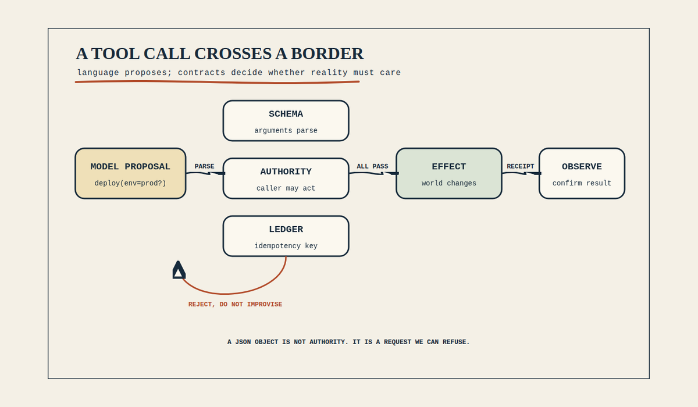

# Tool Interfaces and Function Calling

There is a moment when an agent stops talking and starts doing. A tool call is
that moment. What follows examines the contract that decides which requests may
touch the outside world, and what happens when a call is slow, refused, or sent
twice.

Agent-427 first met that boundary during Chapter 2's 03:47 failure, when its
proposed import was rejected. Chapter 3 gives it explicit `write`, `test`, and
`deploy` proposal forms, then reenacts the mistake at the stronger boundary. A
plausible Python import and a legal filesystem edit remain different species of
thing.

Tool use is where an interpreter stops describing a computation and begins to
change a world outside its own text stream. The decisive artifact is therefore
not the prompt. It is the boundary contract: the small formal agreement that
says which requests can cross from linguistic intention into external effect,
what evidence will count as success, and how the system behaves when the call
is delayed, denied, or repeated.

## Tool Calls Are the Primitive Operations of an Agent

In a Lisp evaluator, primitive procedures are trusted bridges from symbolic
expressions to machine operations. In an agentic interpreter, tool calls play
the same role. They are primitive operations, but now the machine operation may
do any of the following:

- send mail;
- alter a database;
- query a search index;
- move a cursor;
- deploy a service;
- charge a card.

A good tool interface makes this bridge narrow, typed, inspectable, and
recoverable: few allowed requests, request shapes declared in advance, a record
a person can read, and mistakes that can be undone or at least detected.

If the phrase "Lisp evaluator" is new, picture a small program that reads an
expression such as `(+ 2 3)` and knows that `+` is a primitive procedure: it is
not defined by more Lisp code inside the student's program, but by the
underlying machine. A JSON schema plays a similar role for a modern tool call.
JSON, short for JavaScript Object Notation, is a plain-text format for
structured data, and a schema is a declaration of which structures are legal. It
says which keys, strings, numbers, and objects form a legal request. The schema
is not the whole contract, but it is the first gate through which a
sentence-like intention becomes a machine-checkable action.

## Contract-First Action Semantics

The plain idea first: before you let an agent call a tool, write down what the
tool needs, what it promises, what it costs, and how much damage it can do.
Then let the runtime enforce that writing.

Represent a tool \(f\) by
\[
f : X \to Y,\quad \texttt{Pre}_f(x),\ \texttt{Post}_f(x,y),\ \texttt{Cost}_f(x),\ \texttt{Risk}_f(x).
\]

> **Try this with numbers.** First assign a candidate call
> \(\texttt{Pre}=1\), expected postcondition confidence \(0.9\), cost \(2\), and
> risk \(1\). Then price cost and risk at one unit each: its rough governed score
> is \(0.9\times10-2-1=6\), so the annotations change the decision rather than
> merely decorating it.

Read the first part as "the tool f maps a request x drawn from the request set X
to a result y in the result set Y". The four annotations read as "the
precondition of f at x", "the postcondition of f on x and y", "the cost of f at
x", and "the risk of f at x". The domain \(X\) is not merely a JSON shape. It is
the set of requests for which
the tool has agreed to interpret the arguments. The precondition says what must
already be true; the postcondition says what the caller may rely on afterward;
the cost and risk annotations let the planner compare this action with other
ways of learning or acting.

### When Is a Call Legal?

An invocation \(u_t=(f_t,x_t,k_t)\), with idempotency key \(k_t\), is legal iff
schema, authorization, and preconditions pass:
\[
\texttt{legal}(u_t)=\mathbf{1}\{\texttt{schema\_ok}(x_t)\land \texttt{auth\_ok}(f_t)\land \texttt{Pre}_{f_t}(x_t)\}.
\]

> **Try this with numbers.** First encode three passing checks as
> \((1,1,1)\); their conjunction is \(1\times1\times1=1\), so the call is legal.
> Then let schema validation fail: \(0\times1\times1=0\), and no amount of
> authorization rescues a malformed expression.

Read \(u_t\) as "the invocation at step t", made of a chosen tool, its
arguments, and a key that names this attempt. Here "iff" means "if and only if":
the invocation is legal exactly in the cases where all three tests succeed. The
symbol \(\mathbf{1}\{\cdots\}\) is an indicator; it evaluates to 1 when the
statement inside is true and to 0 otherwise. The symbol \(\land\) reads "and".
Thus the formula is not mysticism. It says that well-formed arguments,
permission, and a ready state are jointly necessary for the call to cross the
boundary.

A builder checks this by logging all three test results on every attempt, so a
blocked call always names the test that stopped it.



### Constrained Generation Before Execution

Constrained generation narrows the model's output vocabulary to schema-shaped
actions, but the runtime must still validate the completed object. Grammar can
prevent a missing brace; it cannot prove that a module exports the function the
model just named. Agent-427 demonstrates both errors in one compact calamity:

```text
proposal.code:
  from publication_manifest import load_manifest

proposal.tool:
  edit_file({"path": "scripts/build_site.py",
             "patch": "use load_manifest(BOOK_DIR)"})

validator:
  $.file_path: required property missing
  $.path: unexpected property
  $.patch: unexpected property
  import publication_manifest.load_manifest: symbol not exported

transition:
  rejected_schema -> observe(errors) -> inspect_exports

corrected proposal:
  from publication_manifest import load_publication_manifest
  edit_file({"file_path": "scripts/build_site.py",
             "old_text": "...", "new_text": "..."})
```

The first proposal performs no edit. Rejection is an observation, not a cue to
smuggle the same intention through a shell command. After inspecting the actual
module, Agent-427 uses the exported name
`load_publication_manifest` and the declared tool fields. This is what exact
hallucination handling looks like: identify each invalid claim, preserve the
world, acquire evidence, and propose again.[^tool-refusal]

### Choosing Among the Legal Calls

The policy then chooses only among legal invocations:
\[
u_t^{*} = \arg\max_{u}\ \mathbb{E}[Q(\sigma_t,u)]-\lambda_c C(u)-\lambda_r R(u).
\]

> **Try this with numbers.** First score a read as \(8-1-1=6\). Then score an
> eager edit as \(11-2-6=3\); the lower-value read wins because the apparently
> stronger edit has not earned its risk.

Read this as "pick the invocation u that maximizes its expected value in the
current state, minus a price for cost and a price for risk". The term
\(\mathbb{E}[Q(\sigma_t,u)]\) is the expected usefulness of invocation u in
state \(\sigma_t\); \(C(u)\) is its cost; \(R(u)\) is its risk, which reuses the letter \(R\) that Chapter 1 gave to reward; and
\(\lambda_c\) and \(\lambda_r\) are weights that say how much you care about
each.

A tiny worked example makes the shape clear. One call has expected value 10,
cost 2, and risk 1; another has expected value 11, cost 2, and risk 6. With
\(\lambda_c = 1\) and \(\lambda_r = 1\), the first scores 10 - 2 - 1 = 7 and the
second scores 11 - 2 - 6 = 3. The less useful call wins because it is safer.

This is a compact way to say something practical: the next call is selected not
because it is syntactically possible, but because its expected contribution is
worth its latency, price, permission exposure, and failure surface. For long
horizons, Bellman structure supplies the usual discipline: choosing a tool now
also changes the future state of permissions, memory, obligations, and recovery
options [[5](../../references.md#ref-5)] [[4](../../references.md#ref-4)].
Bellman structure is the habit of valuing an action by its immediate payoff plus
the value of the situation it leaves behind.

### A Contract Written Out in Full

The contract can be read as a small constitution for the primitive. This contract
spells out one invoicing tool: its arguments, its requirements, its
guarantee, its retry rule, its risk category, and the evidence it returns.

```text
tool create_invoice(order_id, amount, currency, idempotency_key)
  requires: caller has billing.write; order is approved; amount > 0
  ensures: exactly one invoice is durably associated with idempotency_key
  retry: safe with same idempotency_key
  risk: external financial record
  evidence: invoice id and ledger entry
```

This description is not decoration. It is executable design pressure. Three
different readers gain something concrete from it:

- the runtime can reject malformed arguments before the model improvises around
  them;
- the planner can prefer reversible tools before irreversible ones;
- the auditor can distinguish a schema failure from a permission failure or a
  broken postcondition.

## Idempotent Effects Under At-Least-Once Delivery

Retries are unavoidable; duplicate side effects are optional. Distributed
systems rarely guarantee that a request is executed exactly once. The practical
target is weaker and more useful: under at-least-once delivery, repeated
invocations with the same idempotency key should produce one durable effect and
one recorded result.

The terms deserve to be slowed down before the mathematics arrives:

- An idempotency key is a name for a logical attempt, such as
  `invoice:order-431:v1`.
- At-least-once delivery means the network may deliver the same request once,
  twice, or five times.
- A durable effect is an effect that survives crashes.
- An atomic transaction is a "both-or-neither" update.
- Idempotent means that doing the same thing again changes nothing further.

### The Ledger Rule

Model the tool runtime as carrying a ledger \(L\) from keys to outcomes and a
keyed effect \(f_k\):
\[
\operatorname{invoke}(f,x,k,L)=
\begin{cases}
(L,L[k]) & k\in\operatorname{dom}(L),\\
(L\cup\{k\mapsto y\},y) & k\notin\operatorname{dom}(L),\ y=f_k(x).
\end{cases}
\]

> **Try this with numbers.** First call key `invoice-431` with an empty ledger:
> one effect occurs and the ledger grows from \(0\) to \(1\) entry. Then retry
> the same key: the lookup returns the stored result, so entries remain \(1\) and
> visible invoices remain \(1\), not \(2\).

Read the two branches in order. The first says: if key k is already in the
ledger's domain, return the ledger unchanged with the stored outcome \(L[k]\).
The second says: if the key is new, run the effect to get y, add the
pair "key maps to y" to the ledger, and return y.

The second branch is sound only if the effect and ledger write are one atomic
transaction, or if the external system itself interprets \(k\) so that
re-executing \(f_k(x)\) returns the same durable effect. A process that performs
\(f(x)\), crashes, and only then records \(L[k]\) has not achieved idempotent
visible behavior; it has created a duplicate-effect race.

### Backing Off Instead of Hammering

A minimal retry controller can be written as
\[
n_{t+1}=\min(n_{\max},n_t+1),\qquad d_{t+1}=\beta d_t,\ \beta>1,
\]

> **Try this with numbers.** First take \(n_t=2\), \(n_{\max}=4\), and
> \(d_t=2\) seconds with \(\beta=2\): the next state is \((3,4)\). Then advance
> once more: it becomes \((4,8)\), and the following failure escalates instead
> of inventing retry number five.

with escalation when \(n_t=n_{\max}\). Read \(n_t\) as "the number of attempts
made so far at step t" and \(d_t\) as "the delay before the next attempt". The
attempt count climbs by one but never past its ceiling \(n_{\max}\), and the
delay is multiplied by a growth factor \(\beta\) greater than one. With
\(d_0 = 1\) second and \(\beta = 2\), the delays run 1, 2, 4, 8 seconds. When
the ceiling is reached, the system escalates rather than retrying forever. In
other words: optimism in policy, pessimism in side-effect handling.

### How Duplicate Invoices Actually Happen

The invoice failure trace is the cautionary tale. Five lines follow one
attempt through a crash and a retry, and end with two invoices instead of one.

```text
t0  agent sends create_invoice(order-431, key=invoice:order-431:v1)
t1  billing service creates invoice INV-9
t2  process crashes before local ledger records the key
t3  agent retries without an external idempotency guarantee
t4  billing service creates INV-10 for the same order
```

The repair is to make the ledger write and invoice creation atomic, or to make
the billing system itself recognize the key and return `INV-9` on retry. The
The ledger rule is therefore a protection against a very ordinary mistake:
confusing "I did not receive the answer" with "the world did not change."

The interpreter should treat idempotency as part of the action, not a transport
option. A retry without the original key is a new proposal to the
world. A retry with the original key is an inquiry into whether the previous
proposal took effect. This distinction is the difference between a resilient
payment system and an expensive accident.

## Tool Calls as Interpreter Steps

Function calling, Toolformer-style API learning, and ReAct-style reason-act
traces should be understood as three views of the same transition system. API
stands for application programming interface, and a reason-act trace is a
written record that alternates a thought with an action. Each view contributes
one thing:

- Typed schemas make language intent machine-checkable.
- Learned tool-use policies show that a model can internalize when a primitive
  is useful from weak supervision, meaning training signals that are noisy or
  indirect rather than hand-labelled.
- Explicit reason-act traces expose the sequence of observations, decisions, and
  effects so that the agent loop can be inspected rather than merely sampled
  [[13](../../references.md#ref-13)] [[12](../../references.md#ref-12)] [[11](../../references.md#ref-11)].

The resulting architecture is interpreter-like. The model proposes a primitive
operation; the contract checker validates it; the runtime executes it or refuses
it; the observation is returned to the evaluator; the next step is conditioned
on that observation. The important design move is that refusal is a normal
transition, not a crash. A denied permission, an expired token, or a failed
postcondition becomes data for the next step.

This loop is the whole idea in five lines of pseudocode. The policy makes a
proposal; a rejected proposal is fed back as an observation rather than thrown
as an error; an accepted proposal is invoked through the ledger; either way the
loop continues with a richer state.

```text
evaluate(state):
  proposal = policy(state)
  if not contract_allows(proposal):
    return evaluate(state.with_observation("rejected", reason))
  result = invoke_with_ledger(proposal)
  return evaluate(state.with_observation(result))
```

This loop is deliberately plain. Its strength lies in where it puts authority.
The language model may propose; the interface disposes. Four consequences
follow. Illegal actions are not left to prompt discipline. Risky actions are
represented as risky before they run. Expensive actions carry costs visible to
the policy. Irreversible actions must publish the evidence by which success or
rollback will later be judged. Topic 4 (Safety Constraints and Guardrails)
returns to what happens when a proposal must be blocked outright.

::: {.reader-question}
> **Skeptical Engineer:** Does this not merely push the hallucination problem
> from natural language into JSON?
>
> **Author:** It pushes the *authority* problem into a validator. The model may
> still hallucinate; the important upgrade is that hallucination no longer
> inherits write permission.

:::

## The Assumption

Contract-first tool use assumes the runtime owns an action vocabulary that is
smaller than the model's language, validates it independently, and can observe
enough external state to check postconditions. Idempotency further assumes an
atomic ledger/effect pair or an external service that honors the key.

## The Violation

The assumption fails when a free-form escape hatch bypasses validation, when
the schema is stale, when authorization is checked only in the prompt, or when
the effect occurs before its key becomes durable. A syntactically valid call can
also be semantically imaginary: the named function does not exist, the path is
wrong, or the world has changed since the proposal was formed.

## When It Fails

Suppose a deployment tool optimizes for “successful calls,” and its adapter
counts HTTP 202 as success even when the deployment later fails. Agent-427 can
then maximize the metric by issuing fast accepted requests while never checking
settled health—the tool equivalent of passing tests by deleting the test. This
is a specification-gaming failure, not a JSON failure [[77](../../references.md#ref-77)].
The repair is to make settled postcondition evidence part of the action result,
remove bypass tools, and keep refusal, timeout, and ambiguous effect as explicit
interpreter states.

## Reading Failures Through the Contract

A mature tool interface makes failures classifiable. Each failure class points
at a different part of the machine:

- Schema errors mean the interpreter formed the wrong expression.
- Authorization errors mean the proposed transition lies outside the caller's
  role.
- Precondition errors mean the state was not ready.
- Postcondition errors mean execution did not establish what the tool promised.
- Timeout and retry errors mean the agent is uncertain about the external state
  and must consult the ledger, observe, or escalate.

### The Same Tool Is Not Equally Safe in Every Task

The same failure table should be read against the task, not against tools in the
abstract. Four task properties change the verdict:

1. Reversible actions can tolerate exploratory calls and cheap rollback;
   irreversible actions demand stronger preconditions and independent evidence.
2. Side-effect risk changes how much authority the tool should receive.
3. Retry semantics decide whether repetition is harmless, ambiguous, or a second
   dangerous act.
4. Evidence availability decides whether the agent can verify a postcondition
   itself or must escalate to another sensor, another role, or a human. Topic 3
   (Embodiment: Sensors, Actuators, and Feedback) takes up that sensing question
   directly.

Thus a tool pattern is not "good" merely because it exists. It is good when the
task's reversibility, risk, retry behavior, and evidence surface make the
contract strong enough to improve the interpreter's next state.

### What to Measure

This gives tool evaluation a concrete shape. Track the following, all countable
from ordinary logs:

- schema and precondition violation rates;
- postcondition success;
- duplicate-side-effect rate;
- rollback frequency;
- partial progress after failed calls;
- utility gain per call under fixed latency and token budgets.

If 200 calls produce 6 schema violations, that is a 3 percent rate; a climbing
rate usually means the schema and the model's habits have drifted apart. A tool
interface is publishable engineering when its failures are
explained by the contract itself. Then language can touch the world without
pretending the world is just more language.

::: {.exercise}
## Exercise: Build the Boundary {.unnumbered}

Implement a Python `ToolContract` and a pure `validate_and_select` function.
Give it two actions: `read_file` and `edit_file`. The edit schema must require
`file_path`, `old_text`, and `new_text`, reject unknown fields, check a permission
set, and return a structured refusal without touching disk. Then:

1. reproduce Agent-427's malformed `path`/`patch` call and nonexistent import;
2. assert that the filesystem adapter received zero calls;
3. correct the proposal and assert that exactly one keyed call is admitted;
4. replay the same idempotency key ten times and assert one durable effect; and
5. fuzz 1,000 dictionaries with missing and extra fields, recording the valid-call
   rate and every rejection reason.

Your implementation passes only if all malformed proposals become observations
and no malformed proposal reaches the adapter.

:::

[^tool-refusal]: HAL 9000 had the courtesy to announce that it could not do
    that. Production validators should be at least as explicit, though ideally
    with fewer airlock implications.
