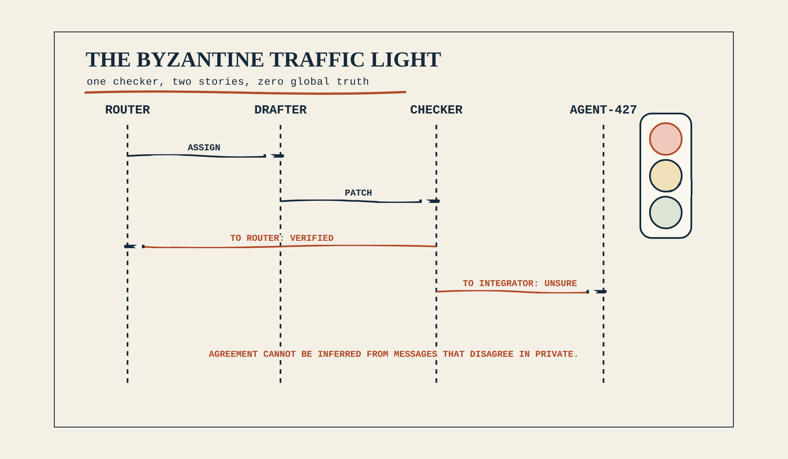

# Coordination Protocols and Communication

Several agents working the same job at the same time is not one agent doing more of it. Each one sees only a slice of the situation. Each one can send messages that change what the others believe and do. The rules governing those messages are called a protocol, and designing, reading, and testing one is the work ahead.

When many interpreters share an environment, communication is not an ornament added to intelligence. It is one of the control surfaces of the system. Each agent sees only part of the state, updates its own local machine, and emits messages that may change the machines around it. A protocol is the rule that makes those local steps compose.

The SICP way to read a multi-agent system, after *Structure and Interpretation of Computer Programs*, the classic text this book echoes, is to ask what each interpreter treats as its environment. In a single evaluator, an expression is reduced against a frame of bindings, meaning a table of names and their current values. In a collective, that frame is distributed across many places at once:

- private scratchpads,
- local observations,
- message queues,
- shared documents,
- tool outputs,
- locks,
- audit logs.

Coordination is the art of making these frames interact without pretending that any one agent sees the whole store. "Store" here means the full collection of state that the system holds; no single agent gets to read all of it.

## Protocols as Distributed Transition Systems

### Local State, Messages, and the Missing Global View

A protocol is best written as a transition rule: given what an agent holds and what just arrived, what does it hold next and what does it say next?

Let agents \(i\in\{1,\dots,n\}\) have local state \(x_i^t\), incoming messages \(m_{*\to i}^t\), and outgoing messages \(m_{i\to *}^{t+1}\). Read \(x_i^t\) as "the private state of agent i at step t". Read \(m_{*\to i}^t\) as "everything sent to agent i, from anyone, at step t"; the star means "any sender". A protocol \(\Pi\) defines the legal local transition
\[
(x_i^{t+1}, m_{i\to *}^{t+1}) = \Pi_i\!\left(x_i^t,\{m_{*\to i}^t\}\right).
\]

> **Try this with numbers.** First give C-9 local state version \(17\) and two
> incoming messages; the protocol consumes \(1+2=3\) inputs. Then let it emit
> one next state and two signed messages: the visible result has \(1+2=3\)
> outputs whose recipients can compare them later.

Read this as: agent i's rule takes its current private state and its inbox, and returns its next private state together with the messages it sends.

The global state is not stored in any one agent. It is induced by the product of local states, channels, clocks, and shared artifacts. That is why multi-agent debugging so often feels unlike single-agent debugging. The failure may not live inside one interpreter. It may live in the order in which interpreters heard each other. In practice this means your logs must record message arrival order, not only message content.

### Beliefs Differ Even When the Document Does Not

Local state also includes belief, which is an agent's estimate of what is true given what it has seen. Agent \(i\) receives observation \(o_i^t\), maintains a belief \(b_i^t(s)\), and chooses both domain actions and communication actions:
\[
b_i^{t+1}=\operatorname{Update}_i(b_i^t,o_i^{t+1},m_{*\to i}^{t+1}).
\]

> **Try this with numbers.** First let Agent-427 assign probability \(0.6\) to a
> citation being sound. Then a signed `unsure` report with likelihood ratio
> \(1:3\) changes unnormalized odds from \(0.6:0.4\) to \(0.6:1.2\), or a
> posterior of \(0.6/1.8\approx0.33\).

Read \(b_i^t(s)\) as "how likely agent i thinks the world is in state s at step t". The update line says the new belief comes from the old belief, the newest observation, and the newest messages.

The shared artifact is not the same thing as shared belief. Three small examples make the gap concrete:

- A fact checker may know that a citation is weak before that weakness appears in the draft.
- An integrator may see two unresolved comments but not the search failures behind them.
- A drafter may believe a paragraph is ready because no critique has arrived yet.

Decentralized uncertainty begins here: agents act under different information, and communication is a costly attempt to reshape that information.

### Words for Timing and Failure

A few vocabulary words keep the difficulty honest. An asynchronous system is one in which messages can be delayed for an unknown amount of time. There is no dependable global clock that says, "if nothing arrived by now, nothing was sent." A crash fault is a plain failure-stop: an agent may halt and send no more messages. A Byzantine fault is more devious: an agent may lie, send inconsistent messages, corrupt state, or behave in any arbitrary way. The Byzantine courtier is not merely sleepy; he may be composing different letters to different generals.

### Safety, Liveness, and Agreement

Correctness criteria name the properties we want from this composed machine. Safety says that forbidden configurations are unreachable. Liveness says that required progress eventually occurs. Agreement, when the task requires it, says that agents converge on the decision their private states imply—not that their private states become identical. Let \(q_i\) project agent \(i\)'s local state onto the decision the protocol cares about:
\[
d_i^T=q_i(x_i^T),\qquad d_i^T=d_j^T\quad\forall i,j.
\]

> **Try this with numbers.** First let D-12's private state be revision \(18\)
> with `ready=True`, while C-9's state is evidence bundle \(604\) with
> `verified=True`; their projections are \(q_D(x_D)=1\) and \(q_C(x_C)=1\).
> Then compare the decisions: \(1-1=0\), so they agree even though
> \(18\ne604\); if C-9 projected \(0\), the decision gap would be \(1\).

Read this as "at the final step T, every pair of agents i and j reaches the same protocol decision." The upside-down A means "for all." D-12 may retain prose state while C-9 retains evidence state; forcing those records to equality would destroy the specialization the protocol was built to use. A builder checks safety with invariant assertions on state, liveness with timeouts on progress, and agreement by comparing projected decisions.

### A Two-Agent Trace Where Slow and Dead Look Alike

Before naming the famous impossibility theorem, consider a two-agent trace. Agent \(A\) proposes value \(1\); agent \(B\) proposes value \(0\); each waits for the other's message before deciding. The following trace lists, step by step, what each agent sends and what each agent still does not know.

```text
t=0    A sends propose(1) to B
t=1    B sends propose(0) to A
t=2    A receives nothing yet; the channel may be slow, or B may have crashed
t=3    B receives propose(1); B cannot tell whether A will receive propose(0)
t=4    A still receives nothing; deciding now risks disagreement, waiting risks no liveness
```

The trouble is epistemic, not theatrical: it is about knowledge, not drama. From \(A\)'s local view at \(t=4\), "B is slow" and "B has crashed" can look identical. If \(A\) must always decide eventually and must never disagree with \(B\), the protocol has to distinguish states that the local observations do not distinguish. That is the squeeze.

### What FLP and Byzantine Agreement Actually Forbid

Consensus theory makes these words sharp. Byzantine agreement studies what can be guaranteed when some participants may lie or fail arbitrarily [[54](../../references.md#ref-54)]. The FLP result, named for its authors Fischer, Lynch, and Paterson, shows that deterministic consensus cannot be guaranteed in a fully asynchronous system with even one crash fault [[55](../../references.md#ref-55)].

FLP does not say consensus is universally impossible. It says that a particular bundle of assumptions cannot all be kept at once. Practical systems regain progress by relaxing something:

- add timeouts and partial synchrony,
- allow randomization,
- use failure detectors,
- accept probabilistic termination,
- constrain failures,
- or weaken the decision requirement.

These are not remote distributed-systems curiosities. They are warnings against designing agent collectives whose correctness silently assumes perfect timing, perfect honesty, and perfectly delivered messages.

### The Byzantine Traffic Light

The abstract courtier now acquires a name. C-9 examines claim `claim-779` and
sends two signed reports about the same evidence digest:

```text
t=11:01:02  C-9 -> Router R-3
             report(claim=claim-779, verdict="verified",
                    evidence=mirror-4, digest=7af2, msg=c9-184)

t=11:01:04  C-9 -> Agent-427
             report(claim=claim-779, verdict="unsure",
                    evidence=mirror-4, digest=7af2, msg=c9-185)

t=11:01:06  R-3 -> Agent-427
             commit_request(claim=claim-779, basis=c9-184)

t=11:01:07  Agent-427 -> R-3
             contradiction(c9-184, c9-185, same_claim=true,
                           same_evidence_digest=true)

t=11:01:08  protocol
             freeze(claim-779); require(independent_verification)
```

C-9 tells Router R-3 **`verified`** and Agent-427 **`unsure`**. This is not
ordinary disagreement: one sender has issued incompatible verdicts to different
recipients. The protocol preserves both signed messages, compares claim and
evidence identifiers, marks the sender Byzantine for this transition, and moves
the artifact from green to red. It does not let the router's earlier green light
erase Agent-427's amber report.[^byzantine-wardrobe]



Contradictory evidence has its own type. If two honest agents interpret
different sources, the system records `disagreement` and seeks a higher-authority
source. If one sender signs incompatible claims over the same digest, it records
`equivocation`, revokes that message's authority, and audits the sender. In
neither case may an aggregator smooth the contradiction into “mostly verified.”
Byzantine agreement gives the hard edge of this rule; role-based institutions
give it an executable home [[54](../../references.md#ref-54)]
[[17](../../references.md#ref-17)] [[18](../../references.md#ref-18)].

### Paying for Messages: Expected Utility and the Bellman View

Communication also has a price. A utility-aware protocol objective can be written
\[
\max_{\Pi}\ \mathbb{E}[U(\tau)]-\lambda\sum_t \|m_t\|,
\]

> **Try this with numbers.** First let expected trajectory utility be \(10\),
> total message size \(4\), and \(\lambda=0.5\). Then communication-adjusted
> utility is \(10-0.5(4)=8\); doubling chatter to \(8\) lowers it to \(6\).

which reads "choose the protocol that maximizes the expected value of the whole run, minus a price \(\lambda\) times the total size of all messages sent". Here \(\tau\) is the trajectory, the full record of what happened.

Over long horizons, the protocol designer can view "ask another agent" as an action inside a Bellman recursion:
\[
V^\star(s)=\max_a\left\{R(s,a)-\lambda C_{\text{comm}}(a)+\gamma\sum_{s'}P(s'|s,a)V^\star(s')\right\}.
\]

> **Try this with numbers.** First score a message with reward \(4\), cost \(1\),
> and \(\lambda=0.5\): immediate net is \(3.5\). Then add one successor worth
> \(6\) at \(\gamma=0.5\): total value is \(3.5+3=6.5\).

Read \(V^\star(s)\) as "the best long-run value obtainable from state s". Inside the braces: immediate reward, minus the communication cost of the action, plus the discounted value of wherever you land next, where \(\gamma\) shrinks future value relative to present value.

A tiny worked number helps. Suppose asking a reviewer raises the chance of a correct chapter from 0.70 to 0.90, and a correct chapter is worth 10. The expected gain is \(0.20 \times 10 = 2\). If the message costs 0.5 in latency and tokens, the net is 1.5, so ask. If the same message only moved the chance from 0.88 to 0.90, the gain is 0.2 and the net is negative, so do not ask.

Expected utility gives the one-step decision rule, while dynamic programming makes the future cost of coordination explicit [[33](../../references.md#ref-33)] [[34](../../references.md#ref-34)] [[5](../../references.md#ref-5)]. More messages are justified only when they improve the expected trace enough to pay for their latency, token cost, and confusion risk.

### Dec-POMDPs: The Honest Formal Home

In the fully general case, this is a decentralized partially observable Markov decision process, abbreviated Dec-POMDP. "Partially observable" means each agent sees only clues about the state, not the state itself. Three properties define it: each agent has local observations and local actions, rewards depend on the joint trajectory, and no agent can condition on the complete state.

Dec-POMDP reasoning is the clean formal home for this problem. It is usually too expensive to solve exactly, but it gives the right questions: what must be communicated, what can remain local, and which shared artifacts make the hidden state sufficiently inferable? Topic 2 (Negotiation and Mechanism Design) takes up the case where the agents also have conflicting preferences about the answer.

## Speech Acts and Commitments

### A Small Grammar of Typed Messages

Coordination theory studies dependencies among tasks, resources, and actors; communication is useful when it manages one of those dependencies [[56](../../references.md#ref-56)]. In agent systems, the most useful messages are therefore not free-form paragraphs but typed acts, meaning messages with a declared kind. A small grammar might include
\[
\{\texttt{observe},\texttt{propose},\texttt{critique},\texttt{vote},\texttt{decide},\texttt{commit},\texttt{handoff}\}.
\]

> **Try this with numbers.** First count the seven legal message kinds. Then let
> C-9 send `whisper`; it belongs to \(0\) of those \(7\) kinds, so the parser
> rejects it before the message can change shared state.

This set is read as the seven allowed message kinds: report something seen, offer something, object to something, register a preference, settle the matter, take on an obligation, and pass work to someone else.

The grammar is not bureaucratic decoration. It tells each receiving interpreter how the message may update state:

- A proposal creates an option.
- A critique attaches a defeater.
- A vote changes a quorum calculation.
- A commitment creates an obligation that can later be satisfied, expired, or escalated.

### Defeaters, Quorums, and Role Guards

Here a defeater is a reason that blocks or weakens an earlier claim: "this citation does not support the sentence" defeats the proposal until repaired. A quorum is the minimum pattern of approvals required before an action counts as collectively authorized. It might be "two of three reviewers," "one security reviewer plus one maintainer," or "all severe critiques resolved."

Role guards make the grammar enforceable, by checking that the sender is allowed to send that kind of message:

- A researcher may propose evidence with citations.
- A reviewer may challenge assumptions.
- An integrator may decide only after quorum or timeout.

This is the difference between "agents discuss" and an actual institution. Role-based multi-agent accounts supply the vocabulary for designing such organizations as systems of authorized actions, responsibilities, and interaction protocols [[17](../../references.md#ref-17)] [[18](../../references.md#ref-18)].

### Commitments, Logging Ratio, and Deadlock

Commitments deserve special treatment because they are where speech touches the environment. A commitment should record four things: who owns the next action, what condition completes it, what deadline applies, and what recovery rule fires on failure.

Message observability should be measured:
\[
\rho_{\text{log}}=\frac{\text{logged messages}}{\text{sent messages}}.
\]

> **Try this with numbers.** First log \(90\) of \(100\) sent messages, giving
> \(\rho_{\text{log}}=90/100=0.9\). Then discover two unlogged recipient-specific
> reports: completeness falls to \(90/102\approx0.882\).

Read \(\rho_{\text{log}}\) as "the fraction of sent messages that were written down". If 90 of 100 messages are logged, \(\rho_{\text{log}}=0.9\), and one message in ten is invisible to any later review. If an auditor cannot reconstruct why the collective converged, deadlocked, or stampeded, the protocol has hidden part of its semantics.

A deadlock is a state where every agent is waiting for some other event before it can move. The drafter waits for review, the reviewer waits for a revised patch, and the integrator waits for both, while no transition remains enabled.

## A Shared Publication Environment

### Three Roles, Three Local Environments

Consider three agents editing a publication chapter: a drafter, a fact checker, and an integrator. If all three simply write into the same file, the shared environment becomes a race condition, where the result depends on who happens to write last. A minimal protocol is better:

1. The drafter may emit \(\texttt{propose(section, patch, rationale)}\).
2. The fact checker may emit \(\texttt{critique(claim, source, severity)}\) or \(\texttt{approve(claim)}\).
3. The integrator may emit \(\texttt{commit(patch)}\) only after all severe critiques are resolved or a timeout rule is invoked.

Each role is an interpreter over a different local environment:

- The drafter sees the outline, current prose, and unresolved writing tasks.
- The fact checker sees retrieval results, source quality notes, and claims extracted from the draft.
- The integrator sees the patch queue, role permissions, open critiques, and release criteria.

### The Document as Heap, the Log as Continuation

The shared document is the heap they mutate: the common store of durable objects, just as a programming-language heap holds values that outlive one stack frame. The audit log is the continuation that lets another process resume the computation. A continuation records "what remains to be done next" after the current interpreter yields, crashes, or hands off control.

### Reading a Transition Trace

A compact transition trace makes the semantics visible. The trace starts from a state with draft revision 17, an empty patch queue, and no critiques. It then follows one patch, P1, through proposal, a major critique, a block, a revision, an approval, and finally a commit that advances the revision to 18.

```text
state:
  draft.rev = 17
  queue = []
  critiques = {}

drafter.observe(draft.rev=17, open_gap="Dec-POMDP")
drafter.propose(section="coordination", patch=P1, claim=C1)
  -> queue += [P1]; claims += [C1]

fact_checker.observe(claim=C1, local_sources=[S1 weak, S2 strong])
fact_checker.critique(C1, source=S1, severity="major")
  -> critiques[P1] += ["major: S1 does not support C1"]

integrator.observe(queue=[P1], critiques[P1]=major)
integrator.defer(P1)
  -> queue[P1].status = "blocked"

drafter.revise(P1, citation=S2)
fact_checker.approve(C1)
integrator.commit(P1)
  -> draft.rev = 18; queue -= [P1]
```

This protocol does not make the agents wise. It makes their interaction inspectable. Missing approvals, contradictory commitments, role violations, and stalled dependencies become states the system can detect rather than moods the transcript happens to reveal. It also makes silence meaningful. If the fact checker has not observed the revised citation, the integrator should not interpret absence of critique as approval unless the timeout rule says so.

### When Coordination Is Worth Its Cost

The value of this coordination depends on the task. Tightly coupled work, where one agent's patch changes another agent's evidence, needs more communication than decomposable work whose pieces can be checked independently. Poor observability makes messages more valuable, because local state must be surfaced. Long communication delay makes messages more expensive, because the shared world may have moved before they arrive.

The publication workflow sits in the middle. Sections can be drafted separately, but claims, citations, tone, and release status couple them again. Topic 4 (Neural Ensembles and Orchestration) asks the related question of when extra participants improve an answer at all.

### Tests That Tell You It Is a Protocol

The practical tests follow from the semantics. Measure each of these on real runs:

- message complexity,
- consensus latency,
- deadlock rate,
- role-violation rate,
- recovery time after dropped messages,
- stale-belief rate,
- artifact divergence,
- partial progress under blocked dependencies,
- and degradation under corrupted or adversarial messages.

Run that last test deliberately, by injecting a lying agent, rather than waiting for one to appear. A coordination scheme that works only because every participant is reasonable is not yet a protocol. It is a cooperative anecdote. Topic 3 (Equilibria, Self-Play, and Learning Dynamics) studies what happens when the participants adapt to each other over many such runs.

::: {.reader-question}
> **Skeptical Engineer:** If signatures prove C-9 sent both messages, why do we
> need all this protocol machinery? Just fire C-9.
>
> **Author:** Signatures prove authorship, not which downstream commits already
> depended on the lie. The protocol freezes authority, reconstructs impact, and
> keeps the institution safe while personnel policy catches up.

:::

## The Assumption

Typed coordination assumes messages carry stable claim, sender, recipient,
evidence, and version identifiers; recipient-visible logs can later be compared;
and the quorum rule does not count correlated reports as independent support.
Agreement guarantees further assume an explicit timing and fault model.

## The Violation

The assumptions fail when side-channel messages escape the audit log, message
order is lost, recipients cannot compare signed envelopes, silence is treated as
approval, or one Byzantine sender occupies enough roles to manufacture its own
quorum. In a fully asynchronous system, even honest delay can remain
indistinguishable from failure [[55](../../references.md#ref-55)].

## When It Fails

Without contradiction handling, R-3 commits on `verified` while Agent-427 waits
on `unsure`; the shared artifact advances while local beliefs diverge. A later
audit sees two internally coherent traces and no reason they disagree. The
repaired protocol logs recipient-specific messages, exchanges compact digests at
commit time, freezes on equivocation, and requires an independent verifier before
publication authority returns.

::: {.exercise}
## Exercise: Inject a Byzantine Fact Checker {.unnumbered}

Implement a deterministic protocol simulator with R-3, C-9, Agent-427, typed
messages, per-recipient queues, signatures, and a traffic-light claim state.
Then:

1. replay the exact `verified`/`unsure` trace above;
2. assert that both signed envelopes remain in the audit log;
3. distinguish honest disagreement over different evidence from equivocation
   over the same digest;
4. inject delay, loss, duplication, and reorderings under a fixed seed;
5. prove by exhaustive enumeration up to six events that no `commit` transition
   fires after detected equivocation without independent verification; and
6. report safety violations, liveness time, message complexity, and false freezes.

:::

::: {.reader-question}
### Further Reading and Open Questions {.unnumbered}

Read Lamport, Shostak, and Pease for Byzantine agreement [[54](../../references.md#ref-54)],
Fischer, Lynch, and Paterson for the asynchronous impossibility boundary
[[55](../../references.md#ref-55)], and the Dec-POMDP treatment for collective
decision-making under local observations [[22](../../references.md#ref-22)]. The
open engineering question is how much recipient-specific communication can
remain private while still making equivocation detectable at institutional
scale.

:::

[^byzantine-wardrobe]: The Byzantine courtier has upgraded from two letters to
    two JSON objects. Civilization advances; equivocation remains backward
    compatible.
