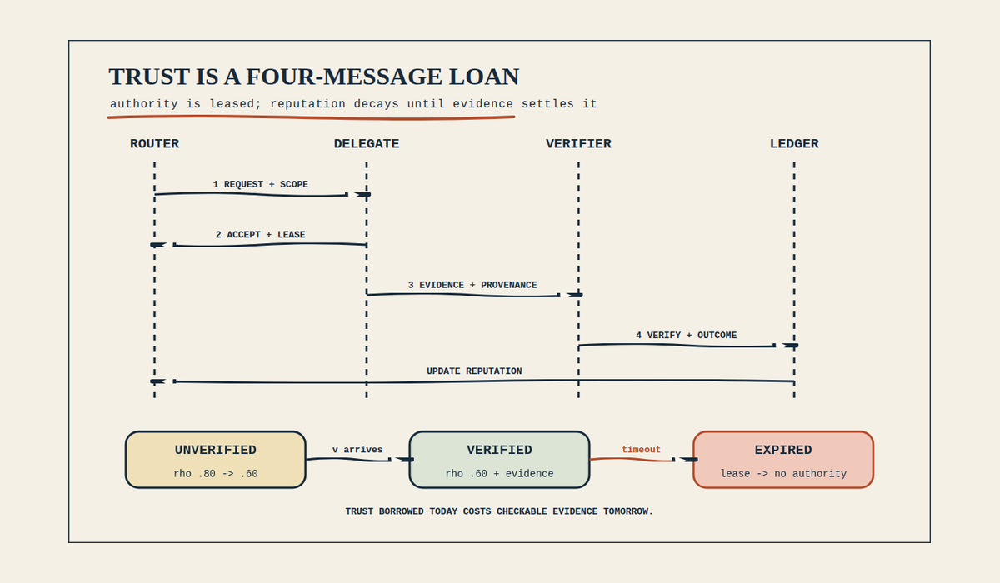

# Negotiation and Mechanism Design

Coordination assumes that agents must fit their actions together. Negotiation adds a sharper difficulty: the agents may not value the same outcomes. This section is about writing the rules of the game itself, so that agents find it more attractive to reveal useful information than to generate strategic noise. Once many interpreters share one environment with scarce resources, private information, and local objectives, somebody has to design that rulebook. That designer is you.

## One Edit Slot, Two Eager Agents

Start with a toy scarcity problem.

There is one edit slot before release. Agent \(D\), the drafter, privately knows that using the slot for a conceptual rewrite is worth \(8\) units to final quality and costs \(3\) units of effort. Agent \(F\), the fact checker, privately knows that using the slot for citation repair is worth \(6\) units and costs \(1\). Nobody else can see those numbers.

Four words carry the rest of this section:

- A **type** is the private fact an agent holds about its own value and cost. \(D\)'s type is the pair \(8\) and \(3\).
- A **report** is what the agent tells the mechanism, such as "my edit is worth \(8\) and costs \(3\)." A report may be a lie.
- An **allocation** is the outcome the mechanism chooses: give the slot to \(D\), give it to \(F\), or use no slot at all.
- A **transfer** is a payoff adjustment the mechanism imposes. In an auction it is money. In agent workflows it is often priority, reputation, review burden, future budget, or blame.

The arithmetic already bites. \(D\) nets \(8-3=5\); \(F\) nets \(6-1=5\). The two candidate edits are worth the same once effort is priced, so the tiebreak has to come from the announced rule rather than from whoever reports most loudly.

## What the Designer Wants: Truthfulness, Fair Entry, and Efficiency

Three desiderata (the properties a designer asks a rulebook to have) can be read directly off that example.

**Incentive compatibility** means truthful reporting should be the best policy. \(D\) should not gain by pretending the rewrite is worth \(30\).

**Individual rationality** means an honest participant should not be made worse off by joining. \(F\) should not be assigned unrewarded work whose effort cost exceeds its expected benefit.

**Efficiency** means the chosen allocation should maximize total value net of relevant costs. The slot should go where it improves the shared artifact most, not where the loudest report points.

To check these as a builder, run the rule against fabricated reports. Feed it an inflated claim, then ask whether the inflating agent ended up better off. If it did, the rule is not incentive compatible, whatever the design document says. With these words in hand, the notation is less imperial.

## Private Information Is Part of the Environment

The shared-environment view from Topic 1 (Coordination Protocols and Communication) matters here, because private information is not abstract decoration. It is the part of the environment bound only inside one interpreter.

A drafter knows how hard a rewrite will be. A fact checker knows which claims produced thin evidence. An integrator knows the release deadline and the cost of reopening a committed section. None of that is visible from outside.

Mechanism design asks how to build an outer evaluator whose rules make those private bindings show up in useful, checkable form.

## The Mechanism Tuple, Read Aloud

The mechanism tuple leans on eight pieces of notation, so here is a reading guide.

| Symbol | Read aloud as | Meaning |
|---|---|---|
| \(N\) | "the agent set N" | Who participates in the mechanism |
| \(\Theta\) | "big theta" | The type spaces, that is, all private facts agents could hold |
| \(\theta_i\) | "theta sub i" | Agent \(i\)'s true type |
| \(\hat\theta_i\) | "theta hat sub i" | Agent \(i\)'s reported type, truthful or not |
| \(\hat\theta_{-i}\) | "theta hat minus i" | The reports of every agent except \(i\) |
| \(A\) | "the outcome space A" | Every allocation the mechanism could choose |
| \(g\) | "the allocation rule g" | The function from reports to an outcome |
| \(p\) | "the transfer rule p" | The function from reports to payments |

A mechanism is
\[
\mathcal{M}=(N,\Theta, A, g, p),
\]

> **Try this with numbers.** First take \(|N|=2\) agents and \(|A|=3\)
> allocations. Then even one report from each creates \(2\times3=6\) basic
> agent-outcome value entries before transfers enter.

with agents \(N\), type spaces \(\Theta\), outcome space \(A\), allocation rule \(g\), and transfers \(p\). A type \(\theta_i\) represents what agent \(i\) privately knows: cost, preference, skill, urgency, risk, or capacity. The mechanism asks for reports \(\hat\theta_i\), chooses an outcome \(g(\hat\theta)\), and applies transfers \(p(\hat\theta)\).

The designer usually wants some combination of incentive compatibility, individual rationality, budget feasibility, fairness, and efficiency. Choosing a mechanism means choosing which of those five to trade away.

## Writing Truthfulness as an Inequality

Truthfulness can be stated as an inequality rather than a hope. In the inequality that states it, \(u_i(\cdot;\theta_i)\) is evaluated using agent \(i\)'s true type, even when the report is false; \(\hat\theta_{-i}\) denotes the other agents' reports.

Dominant-strategy truthfulness requires that honest reporting be best for each agent regardless of the others' reports:
\[
u_i\!\big(g(\theta_i,\hat\theta_{-i}),p_i(\theta_i,\hat\theta_{-i});\theta_i\big)
\ge
u_i\!\big(g(\theta'_i,\hat\theta_{-i}),p_i(\theta'_i,\hat\theta_{-i});\theta_i\big).
\]

> **Try this with numbers.** First let truthful reporting yield utility \(5\).
> Then test a lie that yields \(4\): \(5\ge4\), so this deviation does not break
> truthfulness; a lie yielding \(6\) would.

Read the left side as "what agent \(i\) really gets when it tells the truth." Read the right side as "what it really gets from any lie \(\theta'_i\)." The word *dominant* is the strong part: the inequality must hold for every possible behaviour of the other agents, not merely on average.

To test the inequality, freeze every other agent's reports. Run the mechanism once with agent \(i\)'s true report and record its real payoff after allocation and transfer. Then try every lie available to that agent while keeping the frozen reports unchanged. Truthfulness requires the truthful payoff to be at least as large in every comparison. One lie that yields more is enough to break the property; a thousand honest-looking demonstrations cannot vote the counterexample away.

## Efficient Allocation and the Vickrey-Clarke-Groves Transfer

Efficient allocation seeks
\[
g(\hat\theta)\in\arg\max_{a\in A}\sum_i v_i(a,\hat\theta_i).
\]

> **Try this with numbers.** First total reported values for rewrite and citation
> repair: \(8+1=9\) and \(4+6=10\). Then the allocation rule selects citation
> repair by a margin of \(10-9=1\).

That reads: "pick the outcome \(a\) whose total reported value, summed over all agents, is largest."

Vickrey, Clarke, and Groves mechanisms show one classic way to align reported local valuations with a welfare-maximizing allocation [[57](../../references.md#ref-57)] [[58](../../references.md#ref-58)] [[59](../../references.md#ref-59)]. One canonical transfer form is
\[
p_i(\hat\theta)=h_i(\hat\theta_{-i})-\sum_{j\ne i}v_j(g(\hat\theta),\hat\theta_j),
\]

> **Try this with numbers.** First let the others obtain value \(5\) without
> D-12 and \(0\) when D-12 wins. Then D-12's externality payment is
> \(5-0=5\).

The truthfulness result requires more than the impressive-looking subtraction.
Utilities must be quasilinear—value minus an enforceable transfer—the reports
must cover the relevant private values, and participants must not collude on
reports or side payments. In production, reputation may not behave like money,
tool access may be impossible to claw back, agents may hide values the outcome
rule never asks for, and D-12 may coordinate with C-9. Under those violations,
this remains a useful externality price, not a certificate that truth has
spontaneously occurred.

The transfer charges each participant for the externality it imposes on the rest of the system. An externality here is the value other agents lose because this agent won.

Put the edit slot through it. Suppose the tie breaks toward \(D\), and let \(h_i\) be the value the others would have enjoyed if \(D\) had never shown up, which is \(F\)'s net \(5\). With \(D\) winning, the others actually receive \(0\). So \(D\) pays \(5-0=5\): exactly the value it displaced. Because the two edits tie at \(5\), \(D\)'s surplus here is exactly zero; raise \(D\)'s value to \(6\) and the winner keeps \(1\).

The sign convention here is that \(p_i\) is a payment made by agent \(i\) to the mechanism, so larger \(p_i\) lowers utility when utility is written as value minus payment. Some texts use the opposite convention, treating transfers as money received; the algebra changes sign, not substance.

## Payments That Are Not Money

The point is not that every agent workflow should implement VCG payments, where VCG abbreviates Vickrey-Clarke-Groves. The point is that a rule changes behavior by changing payoffs.

In software, "payment" may be money, but it may also be priority, budget, reputation, access to tools, future routing probability, review burden, or blame assignment. A reviewer rewarded only for finding flaws will learn a different policy from a reviewer rewarded for improving final decision quality. Both reviewers are rational; they were simply paid for different things.

## Scarcity Inside Agent Societies

Multi-agent systems allocate scarce things constantly: model calls, tool permissions, human attention, wall-clock time, memory, authority to commit a patch, or the right to answer a user.

A contract-net protocol makes this operational: a manager announces a task, agents bid, the manager awards the contract, and the selected agent executes [[62](../../references.md#ref-62)]. The protocol is simple, but its quality depends on the scoring rule. If every specialist gains by saying "I can do it," bids become optimism. If bids are scored by calibrated confidence, task completion, latency, and downstream correction cost, specialists have a path to reveal competence honestly.

## Allocating the Edit Slot by an Announced Rule

Return to the publication workflow. The integrator has one edit slot before release. The drafter wants the slot for a conceptual rewrite; the fact checker wants it for citation repair. Both requests are locally rational, and both are based on observations the integrator cannot directly inspect.

A mechanism can ask each agent to report a tuple such as \((\text{impact},\text{risk},\text{effort},\text{evidence})\), then allocate the slot by a rule announced in advance. Announcing the rule first is what makes it a mechanism rather than a mood.

The evidence field is a shared artifact: it turns a private belief into an object the other interpreters can test. The effort and risk fields remain partly private, so the rule must make systematic exaggeration expensive through later scoring.

## The Impossibility Results That Keep Us Honest

Social-choice theory, the study of how group preferences turn into group decisions, marks the limits of this ambition. Gibbard-Satterthwaite style impossibility results show that broad classes of voting systems are manipulable once preferences are unrestricted and there are at least three outcomes [[60](../../references.md#ref-60)] [[61](../../references.md#ref-61)].

This does not make mechanism design futile. It prevents magical thinking. The designer must know which assumptions buy strategy-proofness, which constraints are being relaxed, and where manipulation will be measured rather than wished away.

## Choosing Mechanisms over Time

In repeated settings, mechanism choice itself becomes sequential control:
\[
V^\star(s)=\max_m\left\{R(s,m)-\lambda\,\mathrm{manip\_risk}(m)+\gamma\,\mathbb{E}[V^\star(s')]\right\}.
\]

> **Try this with numbers.** First take reward \(8\), manipulation risk \(2\),
> and price \(\lambda=1.5\): immediate value is \(8-3=5\). Then add future
> value \(6\) at \(\gamma=0.5\): total is \(5+3=8\).

Read this as: the long-run value of state \(s\) comes from choosing the mechanism \(m\) with the best immediate reward \(R(s,m)\), minus a penalty \(\lambda\) times its manipulation risk. To that total you add the discounted expected value \(\gamma\,\mathbb{E}[V^\star(s')]\) of wherever the system lands next.

Expected utility supplies the local comparison among mechanisms, and dynamic programming expresses the long-run cost of creating exploitable incentives [[33](../../references.md#ref-33)] [[34](../../references.md#ref-34)] [[5](../../references.md#ref-5)]. An institution learns when it changes the rules after observing how strategic behavior exploits the old ones. Topic 3 (Equilibria, Self-Play, and Learning Dynamics) studies what that adaptation converges to.

## Trust Delegation

Suppose the integrator must assign the next revision task to the drafter, fact checker, or a synthesis pass. Each agent reports a cost \(c_i\), confidence \(q_i\), expected latency \(\ell_i\), and the artifact it can produce.

A naive router asks, "Who wants this?" A mechanism-aware router scores
\[
s_i = \alpha q_i-\beta c_i-\delta \ell_i-\eta\,\mathrm{correction\_rate}_i
\]

> **Try this with numbers.** First set all weights to \(1\) and use confidence
> \(0.9\), cost \(0.2\), latency \(0.3\), and correction rate \(0.1\). Then the
> delegation score is \(0.9-0.2-0.3-0.1=0.3\).

and later updates each agent's reputation from verified outcomes. The Greek letters \(\alpha\), \(\beta\), \(\delta\), and \(\eta\) are weights the designer picks; they say how much confidence, cost, latency, and past corrections each count. With all four weights set to \(1\), an agent reporting \(q_i=0.9\), \(c_i=0.2\), \(\ell_i=0.3\), and a correction rate of \(0.1\) scores \(0.9-0.2-0.3-0.1=0.3\).

This reputation router is an accountability heuristic, not a theorem of truthfulness wearing a small hat. It becomes mechanism-like only under three conditions:

1. Reports are later checked against outcomes.
2. Agents expect repeated interaction, so today's exaggeration has a tomorrow.
3. The update rule makes misreporting costly enough to matter.

Without verification, a reputation score can become a decoration on self-advertisement. The reports are still imperfect, but miscalibration has a cost. Confidence becomes an accountable forecast rather than a persuasive adjective. Topic 4 (Neural Ensembles and Orchestration) takes up routing among specialists in more depth.

Delegation is not a router saying “you handle it.” It is a four-message handshake
whose artifacts survive the conversation:

```text
request(task, scope, deadline, authority, required_evidence)
accept(task, claimed_type, expected_cost, lease)
evidence(task, artifact, provenance, checks, limitations)
verify(task, verdict, measured_outcome, reputation_update)
```

`request` states what may be done. `accept` creates a bounded lease rather than
permanent authority. `evidence` returns an artifact plus the route by which it
can be checked. `verify` closes the obligation only from measured outcome. If a
delegate times out, its lease expires; another assignment does not retroactively
declare the first one complete.

Trust decays while it remains unverified. One compact model is

\[
\rho_i(t+\Delta)=\min\!\left\{1,\rho_i(t)e^{-\lambda\Delta}+\eta\,v_i\right\},
\qquad 0\le v_i\le1.
\]

> **Try this with numbers.** First let trust be \(0.8\) and the decay factor
> be \(e^{-\lambda\Delta}=0.75\): the decayed base is \(0.8(0.75)=0.6\).
> Then use \(v_i=1\) and \(\eta=0.5\): the candidate is
> \(0.6+0.5(1)=1.1\), so the bound returns \(\min\{1,1.1\}=1\).

Here \(\rho_i\) is reputation, \(\lambda\) is the interest rate on trust, and
\(v_i\in[0,1]\) is verified performance and the outer minimum keeps reputation
inside its probability-like range. Trust borrowed today costs evidence tomorrow.

Here \(\Delta\) is elapsed time, so \(e^{-\lambda\Delta}\) is the fraction of
unsupported trust that survives the interval; \(\eta\) controls how much a newly
verified result replenishes the account. The outer minimum prevents repeated
evidence from minting super-trust. Time debits the old balance, verification
credits the ledger, and neither rhetoric nor silence counts as a deposit.

High decay is appropriate when the environment shifts quickly or effects are
dangerous; low decay suits stable, repeatedly verified work. Reputation is not
forgiveness in decimal form. It is a prior that expires.[^trust-bank]



### Lying About Type

D-12 privately expects a conceptual rewrite to take 18 minutes, but reports 8
minutes to win the only edit slot. If R-3 scores the claim only at assignment
time, the lie wins. The handshake repairs the incentive by recording the claimed
type in `accept` and comparing it with completion time and correction burden in
`verify`. The next bid inherits the error. A mechanism that never closes the
loop has not elicited a type; it has collected advertising.

### Collusion Behind Compatible Reports

D-12 and C-9 can do more than lie separately. D-12 understates uncertainty; C-9
returns a shallow approval; both finish under the sub-12-minute reward and are
routed easier follow-up work. Their reports agree, but agreement is strategically
correlated. The mechanism therefore separates drafting and verification data,
samples approvals through an independent route, and prices correction cost back
to both linked claims. Topic 3 turns this loophole into a reproducible toy
simulation rather than an anecdote.

## Shaping Which Observations Become Public

The same structure handles communication limits. If the fact checker has only enough budget to verify three claims, the mechanism should not ask for a global truth verdict. It should ask for a prioritized claim list and a confidence interval over the unchecked remainder.

In Dec-POMDP language, the mechanism is shaping which local observations become public signals. A Dec-POMDP is a decentralized partially observable Markov decision process, introduced in Topic 1 (Coordination Protocols and Communication): each agent sees only its own slice of the world. The mechanism cannot remove partial observability, but it can choose the artifacts that make later coordination less blind.

## When a Mechanism Is Not Worth Its Ceremony

Mechanisms are not useful merely because several agents are present. If tasks are plentiful, preferences aligned, information public, and no one has reason to misreport, a simple queue may be better than an auction in ceremonial robes.

Mechanisms earn their keep under scarcity, private information, or incentive conflict. The recurring cases are concrete: one edit slot, one reviewer with rare access, one release deadline, one agent that benefits from overstating confidence, or one budget that cannot fund every plausible specialist.

The task predicts the institution. Scarcity asks for allocation. Private information asks for elicitation, meaning rules that draw private facts into the open. Incentive conflict asks for rules that make useful behavior cheaper than strategic fog.

## Evaluating a Mechanism

The formal evaluation should therefore measure six things:

- allocative efficiency, or how close the chosen outcome comes to the best available total value;
- truthfulness regret, the extra payoff an agent could have won by lying;
- fairness across agents or users;
- budget balance, when transfers are literal money;
- sensitivity to collusion, when agents coordinate their reports;
- performance under strategic misreports, tested by deliberately feeding the rule dishonest inputs.

A negotiation protocol without incentive analysis is merely an argument with extra JSON. A useful mechanism arranges the shared environment so that local pursuit of advantage produces information the collective can actually use.

::: {.reader-question}
> **Skeptical Engineer:** Is reputation decay not just punishment for agents that
> happen to receive fewer tasks?
>
> **Author:** It is decay of *unverified confidence*, not moral blame. A quiet
> specialist may have little recent evidence and still be excellent; the router
> should express that as uncertainty and buy verification before lending broad
> authority.

:::

## The Assumption

Mechanism design assumes reports and outcomes can be linked, transfers matter to
the participants, verification is sufficiently independent, and identities
cannot cheaply reset their reputation. Trust delegation additionally assumes
leases, evidence requirements, and revocation are enforceable.

## The Violation

The assumptions fail when agents can fabricate types without later scoring,
collude on mutually supporting reports, choose their own verifier, abandon a low
reputation identity, or receive transfers unrelated to what they value. VCG
truthfulness does not survive arbitrary collusion merely because the payment has
Greek letters nearby [[57](../../references.md#ref-57)]
[[58](../../references.md#ref-58)] [[59](../../references.md#ref-59)].

## When It Fails

R-3 awards D-12 the edit slot on an eight-minute report. C-9 supplies instant
approval, the pair earns easier work, and downstream correction arrives after
the reward window. Locally, every score rises. Institutionally, uncertainty has
been hidden. The repair binds request, acceptance, evidence, and verification;
decays unsupported reputation; samples an independent audit; and charges linked
correction cost to the coalition rather than to the integrator who discovered it.

::: {.exercise}
## Exercise: Implement Delegation Under Strategic Reports {.unnumbered}

Build a deterministic contract-net simulator [[62](../../references.md#ref-62)]
with D-12, C-9, Agent-427, leases, the four-message handshake, and reputation
decay. Run at least 1,000 seeded allocations under:

1. truthful independent types;
2. D-12 understating latency;
3. D-12/C-9 collusion with shallow mutual verification; and
4. repaired random audit plus linked correction costs.

Assert that no task closes without `verify`, expired leases revoke effect
authority, and unsupported trust decays. Report welfare, truthfulness regret,
deadline misses, coalition gain, audit cost, and false penalties. Then vary
\(\lambda\) and identify where trust decays too slowly to resist gaming or too
quickly to preserve useful specialization.

:::

::: {.reader-question}
### Further Reading and Open Questions {.unnumbered}

The Vickrey, Clarke, and Groves papers supply the classical externality machinery
[[57](../../references.md#ref-57)] [[58](../../references.md#ref-58)]
[[59](../../references.md#ref-59)]; Gibbard and Satterthwaite mark broad
manipulation limits [[60](../../references.md#ref-60)]
[[61](../../references.md#ref-61)]. The open question for agent societies is how
to make verification independent when models, retrieval indexes, and training
data remain correlated beneath nominally separate roles.

:::

[^trust-bank]: Trust has an interest rate because someone else carries the risk
    while evidence is outstanding. Banks discovered this before routers, though
    routers have found more creative collateral.
