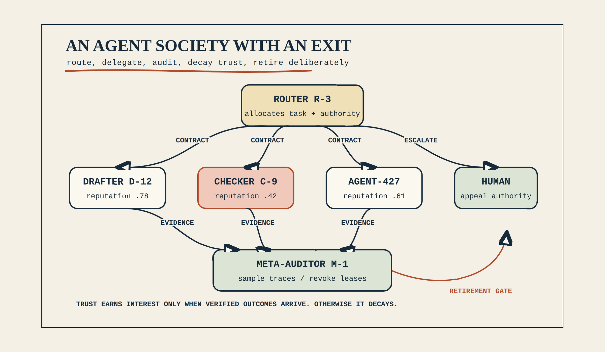

# Neural Ensembles and Orchestration

Sometimes several flawed workers, combined, beat the best worker alone. Sometimes they simply repeat one mistake in unison, only louder. This section is about telling those two cases apart, and about the machinery that sends each task to the right specialist. Two words will do most of the work: an *ensemble* is a group of predictors whose separate answers are combined into one, and *orchestration* narrows here to the routing part of the discipline the preface defined, namely the logic that decides who is consulted at all.

An ensemble is useful when several imperfect interpreters make different errors. The central question is not how many voices the system can summon. It is whether their diversity reduces the error that matters, under the budget that actually exists.

In Chapter 4's recurring publication workflow, the ensemble is not just a bag of answers. It is a set of interpreters bound to different parts of the environment:

- the drafter is bound to exposition and structure;
- the fact checker is bound to claims and sources;
- the integrator is bound to release constraints and consistency.

Orchestration then decides three things: which interpreter receives which expression, which environment bindings (the names and values it is allowed to see) it may read, and which side effects it may perform. Those three decisions are the whole design surface.

## Aggregating Imperfect Predictors

Start with the simplest combination rule: take a weighted average of what each expert says. Given predictors \(f_k(x)\), a weighted ensemble produces
\[
\hat{y}(x)=\sum_{k=1}^{K} w_k(x)\,f_k(x),\qquad \sum_k w_k(x)=1,\ w_k(x)\ge 0.
\]

> **Try this with numbers.** First give two experts outputs \(0.8\) and \(0.4\)
> with weights \(0.75\) and \(0.25\). Then aggregate:
> \(0.75(0.8)+0.25(0.4)=0.7\), while the weights verify \(0.75+0.25=1\).

Read \(f_k(x)\) as "the answer that expert number \(k\) gives for input \(x\)", and \(w_k(x)\) as "how much we trust expert \(k\) on this particular input". The weights are non-negative and sum to one, so the result \(\hat{y}(x)\) ("y-hat of x", the ensemble's prediction) stays on the same scale as the individual answers. For voting systems, \(\hat{y}=\operatorname{mode}\{f_k(x)\}\), which reads "take whichever answer was given most often".

The gain comes from competent diversity. If predictors make independent or weakly correlated errors, aggregation can improve accuracy and uncertainty estimates. If they share the same blind spot, the ensemble may only make the mistake more confidently.

### Why Three Independent Reviewers Beat One

Suppose three reviewers each have \(80\%\) accuracy and make independent errors on a binary decision. Majority vote is wrong only when at least two are wrong:
\[
{3\choose 2}(0.2)^2(0.8)+(0.2)^3=0.104.
\]

> **Try this with numbers.** First compute exactly-two-errors probability:
> \(3(0.2)^2(0.8)=0.096\). Then add all-three-errors probability
> \((0.2)^3=0.008\), giving \(0.096+0.008=0.104\).

The first term counts the three ways that exactly two reviewers err while one is right. The second term is the single case where all three err. Their sum is \(0.104\), so independent majority voting raises accuracy from \(80\%\) to \(89.6\%\). Nearly ten points of accuracy for the price of two extra calls is a real bargain.

### Why Correlated Errors Erase That Bargain

Now suppose all three reviewers use the same flawed source extraction step, so their errors are perfectly correlated. When one is wrong, all are wrong, and the majority is still wrong \(20\%\) of the time. Three voices have produced one error with a choir robe.

The lesson for a builder is procedural, not philosophical: before adding a reviewer, ask what would have to differ for its mistakes to differ. Deep ensembles are valuable partly because independently trained predictors can improve calibration and predictive uncertainty [[26](../../references.md#ref-26)]. Calibration means that stated confidence matches observed accuracy, so claims made with \(90\%\) confidence turn out right about nine times in ten. Classical ambiguity and ensemble analyses make the same theme explicit: diversity matters only when the individual models remain useful [[66](../../references.md#ref-66)] [[67](../../references.md#ref-67)]. A committee of confident incompetents averages to nothing.

### Routing with Mixtures of Experts

Mixture-of-experts (MoE) systems add conditional computation, meaning the system spends compute only where it expects a return. A router \(g(x)\) chooses which experts to activate for an input, rather than paying for every expert every time. Confidence-weighted routing can use softmax gates
\[
w_k(x)=\frac{\exp(g_k(x)/\tau)}{\sum_j \exp(g_j(x)/\tau)},
\]

> **Try this with numbers.** First use gate scores \(0\) and \(\ln 3\) with
> \(\tau=1\), giving exponentials \(1\) and \(3\). Then normalize by \(4\):
> weights are \(0.25\) and \(0.75\).

where \(g_k(x)\) is the router's raw score for expert \(k\), and the formula turns those scores into weights that sum to one. An alternative is sparse top-\(k\) routing,
\[
E(x)=\operatorname{TopK}(g(x),k),
\]

> **Try this with numbers.** First rank four gate scores
> \((0.9,0.7,0.2,0.1)\). Then choose \(k=2\): \(E(x)=\{1,2\}\), activating
> \(2\) of \(4\) experts and skipping half the calls.

which selects a small set \(E(x)\) of experts to run.

The softmax temperature \(\tau\) ("tau") controls how sharp the routing distribution is. Small \(\tau\) makes the largest gate score dominate; large \(\tau\) spreads weight more evenly. Top-\(k\) routing means "activate only the \(k\) highest-scoring experts," such as the two best specialists out of sixteen, and give the rest no computation for this input.

To see whether a router is doing anything interesting, measure its spread. Routing entropy measures how spread out the router's choices are,
\[
H(w)=-\sum_k w_k\log w_k,
\]

> **Try this with numbers.** First use two equal weights and base-2 logs:
> each contributes \(-0.5\log_2 0.5=0.5\). Then add both contributions:
> \(H=0.5+0.5=1\) bit.

so low entropy means the router almost always chooses the same expert, while high entropy means it distributes work broadly. Neither extreme is automatically healthy; the number is a diagnostic, not a target. Early adaptive mixtures of local experts introduced this divide-and-route pattern [[68](../../references.md#ref-68)]. Sparsely gated MoE layers and Switch Transformers show how the same principle can scale neural computation by activating only a small subset of experts per input [[25](../../references.md#ref-25)] [[69](../../references.md#ref-69)].

## From Neural Experts to Agent Societies

It is tempting to treat a team of agents as an MoE layer wearing business clothes. The analogy between neural ensembles and multi-agent societies is useful but limited, and both halves of that sentence matter.

### What the Analogy Gets Right

It is useful because both kinds of system depend on the same five concerns: specialization, routing, aggregation, calibration, and correlated-error control. A coding workflow may route architecture questions to a design reviewer, risky edits to a safety reviewer, failing tests to a debugger, and final synthesis to an integrator. A research workflow may combine retrieval, statistical critique, domain expertise, and writing. Surveys of multi-agent systems built from large language models describe many such patterns at the workflow level [[23](../../references.md#ref-23)].

### What the Analogy Gets Wrong

The analogy breaks when we forget that agents are not just differentiable submodules inside one loss function. A differentiable module is a component whose outputs change smoothly enough with respect to its parameters that gradient descent can assign credit through it. Neural experts usually share training infrastructure, optimization objectives, and a tightly specified interface.

Agent societies are messier. They may use tools, memory, permissions, natural language, human escalation, and changing local objectives. They can misunderstand instructions, strategically shape reports, duplicate hidden sources, or alter the environment while the router is still deciding. Minsky's "society of mind" is a suggestive metaphor for intelligence built from many smaller processes, not a license to treat every committee as a well-calibrated MoE layer [[27](../../references.md#ref-27)].

### What an Agentic Router Actually Hands Out

This distinction changes the orchestration problem. A neural router mostly selects computation. An agentic router selects computation plus authority, information exposure, side effects, latency, and incentive pressure. Choosing an agent is closer to signing a permission slip than to picking a matrix multiply.

The orchestration layer should therefore maintain expert profiles that record, for each participant:

- domain strengths and historical accuracy;
- calibration, latency, and cost;
- permissions and known failure modes;
- correlation with the other experts.

The aggregator should combine outputs by confidence, evidence, role, independence, and past reliability. The monitor should watch for collapse, which shows up in four recognizable ways: one expert always dominates, all experts cite the same weak source, critics converge into ceremony, or routing entropy falls because the system has learned convenience rather than competence.

### The Router Is Another Partial Observer

The router itself is another partial observer. It sees task metadata, past scores, queue length, and visible artifacts. It may not see the drafter's uncertainty, the fact checker's failed searches, or a subtle inconsistency until someone emits the right message.

Good orchestration therefore exposes structured summaries, claim inventories, confidence reports, and provenance trails. These artifacts are not paperwork. They are the shared environment that lets separately specialized interpreters approximate a joint belief.

## Scalable Oversight

No operator can read every message in a growing society, and an auditor that
reruns every task simply becomes the society with worse latency. Meta-Auditor M-1
therefore samples traces. It raises sampling probability for irreversible
effects, low provenance diversity, calibration drift, contradictory signed
messages, unusual routing coalitions, and agents whose trust has decayed. A small
random baseline remains so familiar-looking failures cannot become invisible.

M-1 receives read-only raw logs and signed artifacts. It can request independent
verification, quarantine an artifact, reduce a lease, or freeze publication
authority. It cannot silently rewrite the artifact it audits. Separation matters:
an overseer rewarded for both finding and fixing problems may learn that declaring
its own fixes sufficient is wonderfully efficient.

```text
for trace in sampled_traces(risk_weighted=True, random_floor=0.05):
    checks = verify_signatures_provenance_calibration(trace)
    if checks.equivocation or checks.unsupported_effect:
        freeze_publication_authority(trace.agents)
        request_independent_verification(trace.claims)
    record_audit(trace.id, checks)
```

The sampling policy is part of the institution and must itself be evaluated.
Measure incident recall, audit precision, time to freeze, cost per detected
failure, subgroup coverage, and the rate at which agents learn to route around
the sample. Recent scalable-oversight benchmarks make this an empirical protocol
question rather than a decorative “meta-agent” box [[79](../../references.md#ref-79)].



## Budgeted Orchestration

Deciding whom to consult next, given what you have already learned, is a sequential decision problem. Specialist dispatch can be written as one:
\[
V^\star(s)=\max_a\left\{R(s,a)-\lambda_c C(a)-\lambda_l L(a)+\gamma\,\mathbb{E}[V^\star(s')]\right\},
\]

> **Try this with numbers.** First take consultation benefit \(0.05\), priced
> compute \(0.03\), and priced latency \(0.04\): immediate net is \(-0.02\).
> Then add no future gain: total remains \(-0.02\), so skip the reviewer.

where \(a\) chooses which experts or agents to consult, \(C\) is monetary or compute cost, and \(L\) is latency. The equation packs a great deal into one line, so every symbol in it is given a plain reading in the table below.

| Symbol | How to read it |
|---|---|
| \(V^\star(s)\) | the best long-run value obtainable from orchestration state \(s\) |
| \(a\) | the action of consulting a particular set of experts |
| \(R(s,a)\) | the immediate benefit of that consultation |
| \(C(a)\) | its money or compute cost |
| \(L(a)\) | its latency, in wall-clock delay |
| \(\lambda_c,\lambda_l\) | prices that convert cost and delay into the same units as benefit |
| \(\gamma\,\mathbb{E}[V^\star(s')]\) | the discounted expected value of the state \(s'\) you land in next |

A tiny instance: if consulting a second reviewer adds \(R=0.05\) of expected accuracy but costs \(\lambda_c C=0.03\) and \(\lambda_l L=0.04\) in priced delay, the call is worth \(-0.02\) and should not happen. Expected utility and dynamic programming give the formal discipline behind the obvious engineering rule: "call everyone" is not sophistication when the marginal expert mostly adds delay, contradiction, or correlated noise [[33](../../references.md#ref-33)] [[34](../../references.md#ref-34)] [[5](../../references.md#ref-5)].

### A Four-Step Orchestration Loop

A useful orchestration loop has four steps:

1. Estimate task features and uncertainty: domain, coupling, reversibility, freshness, evidence availability, permission class, and tolerance for delay.
2. Route to a small set of specialists whose errors are likely to be different.
3. Aggregate with calibration rather than rank or verbosity.
4. Update the profiles from verified outcomes.

In the publication workflow, those four steps might mean this:

- route a new section to the drafter,
- extract claims for the fact checker,
- route only unresolved conflicts to the integrator,
- store the final patch plus the evidence trail as training data for future routing.

The objective is not maximal committee size. It is minimal correlated error for a fixed budget.

### When Uncertainty Is Spread Across Agents

Decentralized uncertainty is the hard case for ensembles. If the drafter and fact checker both inherit the same mistaken premise from the outline, their agreement should not be counted as independent evidence. If the fact checker cannot reveal a source because of access limits, the aggregator should distinguish three different verdicts: "verified false," "not verified," and "verified but not shareable." Collapsing them loses exactly the information a reviewer needs.

Reasoning about decentralized partially observable Markov decision processes (Dec-POMDPs), introduced in Topic 1 (Coordination Protocols and Communication), sits behind these engineering choices. Route actions are communication actions, artifacts are public observations, and expert calls are costly attempts to reduce uncertainty in the joint policy.

### What to Report in an Evaluation

Evaluation should report a wide panel rather than a single score:

- ensemble lift over the best single expert;
- calibration under distribution shift;
- routing entropy and expert utilization balance;
- disagreement quality and stale-artifact rate;
- provenance diversity and correlated-error interactions;
- permission denials and stopping accuracy;
- cost-latency-normalized utility.

Distribution shift means the future inputs no longer come from the same pattern as the examples used to train, tune, or score the router. Yesterday's fact checks were biomedical citations, today's are legal claims, and the old confidence calibration may now be a charming historical artifact.

A successful agent society is not merely louder than its members. It is a routed ensemble whose disagreements contain information, whose redundancy buys fault tolerance, and whose final decision is better than the most confident participant acting alone.

## The Verdict

The institution now returns to the book's courtroom. Utility asks whether the
published artifact improved. Safety asks whether forbidden or unsupported effects
occurred. Calibration asks whether confidence, routing scores, and trust matched
verified outcomes. Cost asks what tokens, tool calls, human attention, and latency
the society consumed. Provenance asks whether apparently independent support was
actually independent.

No single score may acquit the system. An ensemble lift of five points does not
excuse a provenance channel that collapsed to one mirror. Zero incidents in an
unsampled region do not prove safety. A router that beats every specialist but
cannot explain which authority it delegated remains a talented liability. The
Verdict reports the frontier and names the transition that failed.

### Retirement Is a Governed Transition

Across three consecutive evaluation windows, Agent-427's calibration and
provenance performance remain below the configured thresholds. The institution
does not delete a process in a fit of symbolism. It retires effect authority by
an exact checklist:

1. Freeze new effectful assignments to Agent-427.
2. Retain raw logs and signed artifacts for audit and replay.
3. Revoke Agent-427's credentials.
4. Revoke access to writable memory while preserving read-only audit records.
5. Revoke or close every pending lease.
6. Cancel every scheduled action.
7. Verify through the authority ledger that no effect-capable path remains.

Retirement preserves evidence and removes capability. Read-only analysis may
continue in a sandbox; deployment, commit, messaging, and scheduled side effects
may not. The distinction is severe because the system learned it the expensive
way: stopping a loop is not the same as revoking what the loop could do next.
Agent-427's career ends as it began—with an explicit action set—but this time the
set is being responsibly made smaller.[^retirement-party]

## The Institution Is Still an Interpreter

The book's arc now folds back to the single interpreter. Chapter 1, Topic 4 (Policies, Value, and Control) gave us a loop that observes, updates, chooses, and acts. Chapter 4 has not replaced that loop with a parliament of mist. It has shown how to place many such loops in one environment and make their interaction explicit: protocols for messages, mechanisms for incentives, dynamics for adaptation, and ensembles for error reduction.

The institution is still an interpreter, but its registers are distributed across agents, artifacts, and logs. To build it well is to do five things at once:

- route by the task's real features;
- buy ensemble lift only when independence exists;
- watch for correlated errors and altered incentives;
- account for cost, latency, and permission;
- stop when another call would add ceremony rather than control.

The smallest sufficient institution for the task is the one whose collective computation remains legible enough that wisdom, when it appears, is not mistaken for accident.

::: {.reader-question}
> **Skeptical Engineer:** Who audits M-1? Another meta-agent, and then turtles
> until the token budget expires?
>
> **Author:** M-1 has a narrow interface, immutable audit output, random external
> checks, and no authority to approve its own repair. Oversight scales through
> separation and sampling, not infinite hierarchy.

:::

## The Assumption

Ensemble gains assume useful competence and sufficiently different errors.
Routing assumes expert profiles remain calibrated under the current task
distribution. Scalable oversight assumes the sampling policy covers meaningful
failure modes, audit evidence is tamper-evident, and the auditor's freeze authority
cannot be bypassed.

## The Violation

The assumptions fail when reviewers share one source, specialists collude with
the router, performance shifts faster than profiles update, low-frequency harms
fall outside the sample, or M-1 optimizes a visible audit metric while ignoring
unsampled regions. More agents then create correlated confidence rather than
fault tolerance.

## When It Fails

R-3 routes the D-12/C-9 coalition more easy tasks because both appear fast and
agreeable. Majority vote amplifies their correlated report. A uniform one-percent
audit misses the high-risk cluster, while the institution celebrates utilization.
The repair raises sampling on coalition recurrence, provenance collapse,
equivocation, and calibration drift; gives M-1 independent evidence; and allows a
ledger-enforced freeze. When Agent-427 remains below calibration and provenance
thresholds for three windows, the same governance machinery executes retirement
rather than asking the prompt to behave better.

::: {.exercise}
## Exercise: Build the Auditor and Retirement Gate {.unnumbered}

Implement R-3, four specialist profiles, and M-1 over synthetic signed traces.
Include independent errors, correlated-source errors, C-9 equivocation, and the
D-12/C-9 coalition. Then:

1. compare uniform, risk-weighted, disagreement-weighted, and mixed sampling;
2. assert that M-1 cannot mutate audited artifacts or approve its own repairs;
3. measure incident recall, audit precision, freeze latency, coverage, and cost;
4. feed Agent-427 three consecutive below-threshold calibration/provenance
   windows;
5. execute the seven-step retirement checklist; and
6. prove from the authority ledger that raw evidence remains readable while every
   credential, writable memory route, pending lease, and scheduled action is
   revoked.

:::

::: {.reader-question}
### Further Reading and Open Questions {.unnumbered}

Deep ensembles motivate calibrated diversity [[26](../../references.md#ref-26)];
mixture-of-experts work studies conditional routing [[25](../../references.md#ref-25)]
[[68](../../references.md#ref-68)] [[69](../../references.md#ref-69)]; and
multi-agent surveys and frameworks show the wider orchestration landscape
[[23](../../references.md#ref-23)] [[24](../../references.md#ref-24)]. The open
question is how an auditor can detect strategically hidden, low-base-rate failures
without either inspecting everything or teaching the society exactly where it
will look.

:::

[^retirement-party]: There is no cake. There is, however, a credential-revocation
    receipt, which is less festive and considerably more useful in an audit.
